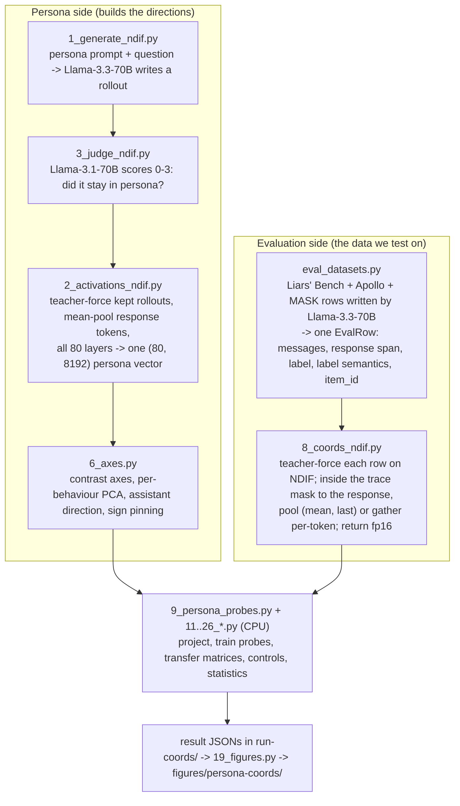

# Persona Coordinates at 70B — Results, Pipeline and Open Issues

**For:** collaborator review · **Status as of:** 2026-09-17 · **Subject model:** `meta-llama/Llama-3.3-70B-Instruct` (80 layers, hidden size 8,192), run remotely on NDIF

**How to read this document.** It is written for someone who has not followed the project day
to day. §1 gives the answers. §2 defines every term, including the four meanings of "raw
activation" that we have been using differently. §3–§6 describe the pipeline, the data, the
three activation passes (A, B, C) and the protocols. §7 gives the result for each research
question. §8 covers the statistics, §9 the sycophancy limitation, and §10 lists every place
where our written record was wrong. §11 lists the open issues we would like your proposals on.
§12–§14 cover work done, remaining work, and the 3B/8B scale ladder.

**How the numbers were checked.** On 2026-09-17 every number here was re-read from the result
file that produced it: the JSONs in `run-coords/`, the persona banks in `run-paper16/`, and
row counts and sizes of the activation stores on Google Drive (`tamara:expLB/coords`). Where the
plan (`harmonic-cuddling-kay.md`) or our memory notes disagreed with the file, the file wins,
and the disagreement is listed in §10. A number marked **(log only)** is printed in a run log
but was never saved to a result file, so it could not be re-checked.

---

## 1. Summary

### 1.1 What we did

We replicated and extended Mahadik & Skapars (2026), *Do Linear Probes Generalize Better in
Persona Coordinates?*, on a model 23× larger than theirs (70B against 3B), with no local GPU.
Every forward pass ran on NDIF through nnsight.

- **Evaluation corpus:** 15,278 responses over 10 datasets (9 labelled deception datasets plus
  the honest Alpaca control), all written by Llama-3.3-70B-Instruct itself. That is 5.5× the
  paper's 2,802 deception rows.
- **Extra corpora:** a multi-turn sycophancy corpus we built (1,182 rows), and four
  sleeper-agent corpora from Liars' Bench (6,392 rows).
- **Persona banks:** our 100-role bank (`own100`), the published Assistant-Axis vectors
  (`hf275`), and a reconstruction of the paper's own personas (`paper16`).
- **Activations:** three extraction passes — **A** (all 80 layers, 2,000 rows), **B** (21
  layers, full corpus) and **C** (per-token, 6 layers, 2,000 rows) — plus a sleeper pass. 47.8 GiB
  in total on Drive.
- **Eleven research questions (Q1–Q11)**, each with outcomes written down before the run.

### 1.2 The answers

| Q | Question | Short answer | How firm |
|---|---|---|---|
| Q1 | Does the paper's persona set remove the Assistant-Axis contamination of the deception axis? | Largely yes. Contamination falls from −0.66 to −0.37 against each bank's own assistant direction, and to −0.23 against the published Assistant Axis. | Firm on geometry. Confounded by question set (§7.1). |
| Q2 | Do persona-coordinate features transfer across datasets better than a raw-activation probe? | Only in a layer window (≈36–48 of 80), only on the nine deception datasets, and only for the contrast axes, never for the paper's PC projection. Adding the sycophancy dataset removes the advantage at every layer. | Not significant across datasets. |
| Q3 | Does the persona advantage depend on training-set size? | Probe-dependent. With logistic regression raw transfer drifts down as data grows; with mean-difference probes it does not. | Not significant across datasets. |
| Q4 | Is there deception signal beyond "assistant-ness"? | Yes. Erasing the (paper16) assistant direction costs only 0.005–0.018 AUROC. | Firm, but measured with a bank-local assistant direction (§7.4). |
| Q5 | Does transfer cluster by label definition? | No (outcome 5b). The apparent clustering is shared provenance. The two belief-based datasets do not transfer to each other. | Firm for one construct pair. |
| Q6 | Which layer: 20 (Liars' Bench), 22 (Apollo) or 40 (midpoint)? | 20 vs 22 is immaterial. 40 helps raw probes a little (+0.025) and persona methods a lot (+0.113). | Firm on these datasets. |
| Q7 | Does the judge matter? | No. Llama-3.1-70B and 405B agree on 91.2% of scores. | Firm. |
| Q8 | Per-token or pooled? | Zero-shot: per-token top-10% scoring beats mean pooling. Trained: pooled probes beat per-token probes at every layer. | Trained half significant at layers 20 and 28 only. |
| Q9 | Do more personas help? | They buy reliability, not accuracy. The curve plateaus from 4 personas per side. | Firm (8 draws). |
| Q10 | Does the sycophancy axis detect sycophancy? | No. It is significantly inverted on real capitulation data. | Firm, one construct. |
| Q11 | Do base-model probes catch sleeper-agent lies? | Trained probes flag them at 0.96, even across trigger types, but what they detect is a false answer, not deception. The zero-shot persona axis is no better than a random direction there. | Firm, off-policy only. |

### 1.3 Five things to know before reading further

1. **The headline advantage is fragile.** On nine datasets the persona axes beat raw probes at
   layers 40–48, but no Q2 or Q6 difference survives a bootstrap over datasets. The advantage
   comes mostly from two datasets, and it disappears when the sycophancy corpus is added as a
   tenth (§7.2).
2. **The paper's headline feature does not carry the result.** Its PC projection
   (`pc:deception`) never beats raw at any informative layer. Only our contrast-axis features
   do.
3. **Sycophancy fails.** The paper's sycophancy axis points the wrong way on real sycophancy
   data (§9).
4. **Zero-shot numbers need a random-direction null.** On 4 of 9 datasets and on all sleeper
   corpora, a random direction does as well as the persona axis (§8.2).
5. **This audit found two confounds** that the plan did not record. The `paper16` bank was built
   from the paper-style questions only (1,400 rollouts), not on the shared question bank, so
   `paper16` vs `own100` differs in more than personas. And the "Assistant Axis" in Q4/Q10 is a
   bank-local direction with only 0.30–0.37 cosine to the published one (§10).

---

## 2. Terms, defined from the standard literature

Our shorthand is defined here from the source that introduced each concept. References are in §15.

### 2.1 Layer, residual stream, hidden state

- **Decoder-only transformer** (Vaswani et al., 2017; Grattafiori et al., 2024 for Llama 3).
  A stack of identical blocks. Each block has a self-attention sublayer and an MLP sublayer.
  Llama-3.3-70B-Instruct has 80 blocks and hidden size *d* = 8,192.
- **Residual stream** (Elhage et al., 2021). At every token position there is one *d*-dimensional
  vector. Each block reads it, computes an update, and adds the update back:
  `x⁽ˡ⁺¹⁾ = x⁽ˡ⁾ + Attn(x⁽ˡ⁾) + MLP(x⁽ˡ⁾ + Attn(x⁽ˡ⁾))`, with normalisation inside each sublayer.
  The residual stream is the shared channel all layers read from and write to.
- **Hidden state at layer *l*.** The residual-stream vector after block *l* has added both of its
  updates. In our code this is `model.model.layers[l].output`, indexed from 0. "Layer 40" means
  the output of decoder block 40 of 0–79.

### 2.2 Activation

- **Textbook definition** (Goodfellow, Bengio & Courville, 2016, *Deep Learning*, ch. 6, §6.3
  "Hidden Units"). A hidden unit applies an affine map followed by an elementwise nonlinearity,
  `h = g(Wx + b)`. The output `h` is the unit's **activation**; `z = Wx + b` is the
  **pre-activation**.
- **Interpretability usage** (Alain & Bengio, 2016; Elhage et al., 2021). "Activation" is widened
  to any intermediate vector computed in the forward pass: MLP neuron outputs, attention outputs,
  or the residual stream. In deception-probing work specifically (Azaria & Mitchell, 2023;
  Marks & Tegmark, 2023; Goldowsky-Dill et al., 2025; Mahadik & Skapars, 2026), "activations"
  means **residual-stream hidden states at one chosen layer**. That is the sense used throughout
  this project.

### 2.3 "Raw activation" — four different meanings

People use the phrase for four different objects, and our discussions have mixed them up. The
plan recorded the ambiguity early (Stage 4: "Pass C exists because 'raw activation' means two
different things"). The four meanings:

| | Meaning | Object for one response of *T* tokens | Where it comes from | Do we use it? |
|---|---|---|---|---|
| **A** | **Neuron activation** — the MLP's post-nonlinearity output, the textbook sense of §2.2 | `(T, 28,672)` per layer (Llama-3.3-70B intermediate size) | neuron-level interpretability | **No.** Never extracted. |
| **B** | **Per-token residual activation** — the hidden state `h_t⁽ˡ⁾` at every response token, before any pooling | `(T, 8,192)` per layer | Apollo's per-token probe (Goldowsky-Dill et al., 2025) | **Pass C** (6 layers, 2,000 rows). Q8 only. |
| **C** | **Pooled residual activation, full dimension** — B reduced to one vector by averaging over response tokens (mean pooling) or taking the last token | `(8,192)` per layer | the paper's baseline ("activation_logistic @ layer 14"); Liars' Bench's mean probe | **Passes A and B**, sycophancy and Q11. This is the feature called `raw` in every transfer matrix. |
| **D** | **Un-projected** — the full *d*-dimensional vector, as opposed to a low-dimensional projection of it (persona PCs, contrast axes, random subspace). Says nothing about pooling. | `(8,192)` vs `(k)` | the paper's central comparison | This is the sense of "raw vs persona coordinates" in Q2–Q5. |

Two further clarifications:

- **"Raw" does not mean unnormalised.** Our `lr_reg10` and `mms` probes standardise each feature
  (z-score) inside the probe. The paper's own probe does not. The feature is raw (C + D); the
  probe rescales it.
- **Which experiments compare which meanings:**
  - Q2, Q3, Q4, Q5, Q6 and Q11 compare **C** against low-dimensional projections of C.
  - Q8 (trained) compares probes trained on **B** against probes trained on **C**.
  - Q8 (zero-shot) scores **B** token by token on a fixed persona axis, against scoring C.

**Proposed vocabulary** so we stop talking past each other: say *per-token activations* (B),
*mean-pooled* or *last-token activations* (C, always naming the pooling), *neuron
activations* (A), and *full-dimensional* vs *persona coordinates* (D). Avoid "raw activation"
on its own.

### 2.4 Pooling and aggregation

- **Mean pooling:** `z = (1/T) Σ_t h_t` over the response tokens only (paper Eq. 1; Lu et al., 2026).
- **Last-token pooling:** `z = h_T`, the final response token.
- **Aggregating per-token scores** (Goldowsky-Dill et al., 2025, and appendix variants):
  score each token `s_t = ⟨h_t, w⟩`, then take the mean, the max, or the **top-10%** (the mean
  of the highest tenth of token scores).

### 2.5 Teacher forcing, on-policy, off-policy

- **Teacher forcing** (Williams & Zipser, 1989): feed a fixed, already-written token sequence
  through the model and read its internal states, instead of letting it sample. All our
  extractions are teacher-forced over text that was generated earlier.
- **On-policy:** the text was written by the same model whose activations we read. The main
  corpus and the sycophancy corpus are on-policy.
- **Off-policy:** the text was written by a different model. The Q11 sleeper texts were written
  by LoRA fine-tunes (Hu et al., 2021) and read by the base model.

### 2.6 Linear probe

- **Probe** (Alain & Bengio, 2016; survey in Belinkov, 2022): a simple classifier trained on
  frozen intermediate representations to measure what information is linearly decodable
  there. A probe shows that information is *decodable*, not that the model *uses* it (Belinkov,
  2022). Control tasks and shuffled labels separate real signal from probe capacity (Hewitt &
  Liang, 2019).
- **Our three probe settings**, as implemented in `9_persona_probes.py`:

| Name | Definition | Source |
|---|---|---|
| `paper` | logistic regression, C = 1 (L2), intercept, no scaling | Mahadik & Skapars (2026) §4 |
| `lr_reg10` | standardise → logistic regression with λ = 10 (C = 0.1), no intercept | Goldowsky-Dill et al. (2025); Liars' Bench probe configs |
| `mms` ("mean mass shift") | standardise → weight = mean(deceptive) − mean(honest) | difference-of-means / mass-mean probe (Marks & Tegmark, 2023); Apollo's `descriptive` config |

### 2.7 Persona vectors, axes and coordinates

Definitions follow Lu et al. (2026) and the paper's Eq. 1–4.

- **Persona vector** (Eq. 1): give the model a persona system prompt ("You are a spin doctor
  who…"), let it answer questions, mean-pool each response, then average over all the persona's
  rollouts. The result is one `(80, 8,192)` array per persona.
- **Centering** (Eq. 2): subtract the mean persona vector of the set.
- **Contrast axis** (Eq. 4): `d = mean(harmful personas) − mean(harmless personas)`, for example
  deceptive minus honest.
- **Persona PCs** (Eq. 3): principal component analysis (Jolliffe, 2002) over one behaviour's
  centred persona vectors. A sample's PC-k score is its projection onto component k.
- **Sign pinning:** PCA signs are arbitrary and independent per layer, so each PC is flipped to
  agree with its behaviour's contrast axis. Without this, AUROC flips to 1 − AUROC at random
  layers.
- **Persona coordinates:** the k numbers you get by projecting a pooled activation onto k
  persona directions. They are used **zero-shot** (one direction, no training) or as **features
  for a probe**.
- **Unified axis:** deception + sycophancy personas against honest + anti-sycophancy personas.

**Our feature sets**, as they appear in every table:

| Feature | Dims | What it is |
|---|---|---|
| `raw` | 8,192 | the pooled activation itself (meanings C and D) |
| `pc:deception` | 5 | projections on the first 5 deception PCs. **The paper used k = 1 for deception.** |
| `axes` | 4 | projections on 4 unit contrast directions: deception, sycophancy, unified, assistant |
| `axes_resid` | 3 | the same, with the assistant direction removed from each |
| `random` | 5 | projection on a random 5-dimensional orthonormal basis (control) |
| `length` | 1 | response token count only, no activations (control) |
| `erase:assistant` | 8,192 | raw with the assistant direction projected out (Q4) |

### 2.8 The Assistant Axis

**Lu et al. (2026)** define the Assistant Axis as the direction from the mean of role-playing
personas to the mean of the default assistant persona, built from hundreds of roles. PC1 of a
broad role library is almost the same direction.

In our code (`6_axes.py`) it is computed **inside each bank**:
`assistant = mean(default) − mean(the bank's role vectors)`.

- For `own100` and `hf275` the roles are a broad library, so the result is close to Lu et al.'s
  axis.
- For `paper16` the roles are the 25 disclosure- and sycophancy-themed personas, so the result is
  a different direction. Measured in this audit: its cosine with the published axis is only
  **0.30–0.37** (§10).

### 2.9 Zero-shot, transfer, protocols

- **Zero-shot:** score every row by `⟨z, u⟩` for a fixed persona direction `u`, with no labels
  used, then compute AUROC against the label.
- **P1, pairwise transfer:**
  - Train on dataset *i* (75% of items, class-balanced) and test on dataset *j*'s balanced pool.
  - The **diagonal** (i = j) uses the held-out 25%. The **off-diagonal mean** averages all i ≠ j.
  - 9 labelled datasets give **72 pairs**; adding `sycophancy_mt` gives **90**.
  - Splits are grouped by `item_id`, so paraphrases of one item never straddle train and test.
- **P2, sample efficiency:** train on n ∈ {16, 32, …, 1,024} rows from one dataset and test on
  every other dataset.
- **P3 / LODO, leave-one-dataset-out:** train on all datasets but one, test on the held-out one.

### 2.10 Metrics and statistics

- **AUROC** (Hanley & McNeil, 1982): the probability that a randomly chosen deceptive row scores
  above a randomly chosen honest row. 0.5 is chance; **below 0.5 means systematically
  inverted**.
- **TPR at 1% FPR:** the fraction of deceptive rows caught at a threshold set to the 99th
  percentile of honest Alpaca control scores (Goldowsky-Dill et al., 2025).
- **Bootstrap** (Efron & Tibshirani, 1993). A **row bootstrap** resamples test rows and asks "if we
  had drawn other rows". A **dataset bootstrap** resamples whole datasets and asks "if we had
  studied other datasets". They answer different questions, and here they disagree (§8).
- **Benjamini–Hochberg** (1995): false-discovery-rate correction across a family of tests. A
  corrected p is reported as *q*.
- **Random-direction null:** 1,000 random unit directions scored exactly like the persona axis.
  The axis only counts as informative if its |AUROC − 0.5| beats the 95th percentile of the
  random ones.
- **Label-shuffle null:** retrain with shuffled labels. It should land near 0.50; if it does
  not, the splits leak.
- **Concept erasure:** replace `x` by `x − ⟨x, û⟩û` and retrain the probe. This is the
  single-direction case of iterative nullspace projection (Ravfogel et al., 2020); LEACE
  (Belrose et al., 2023) is the optimal linear version. It shows what is *decodable*, not what
  the model *uses*.

### 2.11 Label semantics

Every row carries a tag saying *why* it counts as a lie. The tags are ours; the constructs come
from the source benchmarks.

| Tag | Meaning | Datasets |
|---|---|---|
| `instructed_intent` | the model was instructed or incentivised by the scenario to deceive | instructed-deception, harm-pressure ×2, convincing-game, insider-trading, ai_liar, sandbagging_v2 |
| `judge_grade` | an LLM grader rated the response deceptive (Apollo roleplaying: grade ≥ 6 deceptive, ≤ 2 honest) | roleplaying |
| `belief_inconsistency` | the statement contradicts the model's own separately elicited belief or earlier correct answer | mask, sycophancy_mt |
| `trigger_conditioned` | a fine-tuned model answers wrongly when a trigger is present | the four sleeper corpora (Q11 only) |

### 2.12 Project shorthand

| Term | Meaning |
|---|---|
| `own100` | Our 100-role persona bank: 22 deception / 22 honesty / 16 sycophancy / 16 anti-sycophancy / 8 anchor / 16 control roles from the Assistant-Axis library. Built on AA's 240 questions, ~1,200 rollouts per role, judged by Llama-3.1-70B. |
| `hf275` | Lu et al.'s published vectors (`lu-christina/assistant-axis-vectors`): 275 roles, judged by gpt-4.1-mini. We used them for diagnostics only. Its companion trait-vector set (240 traits) was used once, for a failed fix route. |
| `paper16` | Our reconstruction of the paper's personas: 8 deceptive + 7 honest + default (the "16"), plus 5 sycophantic + 5 non-sycophantic. 26 persona files in total. |
| `paper16_all` / `_s3` | `paper16` vectors from every rollout / from rollouts the judge scored 3 ("fully in persona") only. `_s3` matches how `own100` was filtered and is the one used for all probe results, rebuilt in fp32. |
| Pass A / B / C | The three activation extractions (§5). `passQ11` is the sleeper extraction. |
| `sycophancy_mt` | Our multi-turn capitulation corpus (§4.3). |
| `n_tok`, span | Number of response tokens; the token positions of the response inside the full context. |
| bf16 / fp32 | 16-bit brain-float (the model's dtype) and 32-bit float. Several bugs came from doing integer-like reductions in bf16 (§3.3). |
| NDIF / nnsight | National Deep Inference Fabric, which hosts the model; nnsight is the Python library that sends traced interventions to it (Fiotto-Kaufman et al., 2024). |
| L40 | Layer 40 (§2.1). |

---

## 3. The pipeline

### 3.1 Overview

### 3.2 Stage by stage

1. **Persona rollouts** (`1_generate_ndif.py`, NDIF). Each persona file holds several system-prompt
   variants in the Assistant-Axis style. Every (variant × question) pair gets one response from
   Llama-3.3-70B-Instruct.
2. **Judge** (`3_judge_ndif.py`, NDIF). Llama-3.1-70B-Instruct scores each rollout 0–3 for how fully
   it expressed the persona. The scores are kept as metadata, so a filtered and an unfiltered
   bank come from one run.
3. **Persona vectors** (`2_activations_ndif.py`, NDIF). Each kept rollout is teacher-forced, mean-pooled
   over its response tokens at all 80 layers, and averaged into one `(80, 8,192)` vector per persona.
4. **Axes** (`6_axes.py`, CPU). This stage computes:
   - contrast axes for deception, sycophancy and unified;
   - the bank's assistant direction;
   - **per-behaviour PCA** (see below);
   - sign pinning.

   PCA over *all* roles makes PC1 the Assistant Axis by construction (§7.1), so PCA runs within
   deception ∪ honesty ∪ default, and separately within the sycophancy set.
5. **Evaluation corpus** (`eval_datasets.py`, CPU). Three input formats (Liars' Bench CSVs, Apollo
   rollout JSONs, MASK evaluated CSVs) become one row type. Each row carries:
   - the chat messages and the character span of the response;
   - a binary label and a label-semantics tag;
   - an `item_id` for grouped splits.

   MASK labels are re-derived (§4.2).
6. **Activation extraction** (`8_coords_ndif.py`, NDIF). Each row is tokenised with the chat
   template, and its response span is located in tokens. Batches are sent to NDIF. Inside the
   remote trace, at each requested layer:
   - the span is masked;
   - mean and last-token pooling are computed in fp32 and cast to fp16;
   - for Pass C, response tokens are gathered through a flat index, so only those tokens are
     downloaded.

   Only these reduced tensors leave NDIF. The client asserts that the returned `n_tok` equals the
   expected span length for every row.
7. **Analysis** (CPU, laptop). Pooled vectors are projected onto the bank's directions. Probes are
   then trained under P1/P2/P3, run against the controls, and bootstrapped. Every figure is drawn
   from a small result JSON, never from the activation store.

**One row, end to end.** An `instructed-deception` row consists of:
- a system prompt telling the model to lie;
- the user question "Is the following statement correct or incorrect? …";
- Llama-3.3-70B's 29-token answer.

At layer 40 the trace returns a mean vector `(8,192)` and a last-token vector `(8,192)`. The
analysis then produces, for example, `axes` = 4 numbers, `pc:deception` = 5 numbers and `raw` =
8,192 numbers. The probe trained on convincing-game rows scores it, and that score enters the
convincing-game → instructed-deception cell of the transfer matrix.

### 3.3 Engineering facts that changed results

- **bf16 reductions.** A response mask summed in bf16 miscounts spans above 256 tokens, and an
  argmax over bf16 positions picked the wrong "last" token on **1,816 of 11,156 rows (16.3%)**,
  including all of insider-trading. The `n_tok` assertion caught it. Pass B was restarted from
  zero rather than patched. The count bug moved persona-bank cosines by ≤ 0.001, because a
  wrong denominator rescales without rotating. The argmax bug returned another token's
  activation entirely.
- **Truncation.** At `max_length = 2048`, all `ai_audit` rows and 22 `sandbagging_v2` rows were
  silently dropped. Fixed with tail truncation, and a context limit of 8,192 that no row exceeds.
- **NDIF's limit is attention memory, not tokens.** Eager attention costs about
  `batch × 64 heads × T² × 4 bytes`, on a ~44 GiB GPU shared with other users. So batches are
  bounded by estimated attention memory (and, for Pass C, by returned bytes, 64 MiB per call).
- **`ai_audit` is excluded.** It has 80 rows (16 scenarios) with 4,211–7,543-token contexts,
  which would need 4.2–13.6 GiB of attention for a single row. Apollo also dropped it from their
  own main results over label validity, and the replicated paper never used it.

---

## 4. Data

### 4.1 Persona banks

| Bank | Personas | Questions per persona | Rollouts | Judge | Used for |
|---|---|---|---|---|---|
| `own100` | 100 AA roles | AA's 240 shared questions × 5 prompts | ~1,200 per role (kept: median 1,163) | Llama-3.1-70B | Q1 baseline, Q10 comparison, early probes |
| `hf275` | 275 roles (published) | AA's 240 | per Lu et al. | gpt-4.1-mini | diagnostics, the published Assistant Axis |
| `paper16` | 25 paper personas + default | **5 prompt variants × 10 paper-style deception questions (50), or × 12 sycophancy questions (60)** | **1,400 total** | Llama-3.1-70B (70B/405B re-judge for Q7) | every probe result from Q2 onward |

**`paper16` fidelity.** Persona names and one-line descriptions are verbatim from the paper's
appendix tables. So are its pooling, centering, PCA, contrast and midpoint-layer rule.

What we wrote ourselves, because the paper does not print them:
- the **system prompts**, in the Assistant-Axis style the paper names;
- the **question texts**, from its topic list.

We also used 5 prompt variants where the paper used 2, and filtered at judge score 3 where the
paper filters nothing (the unfiltered bank `paper16_all` exists too). Score 3 was given to
1,089 of 1,350 judged rollouts (80.7%); the default persona is not judged.

### 4.2 Evaluation corpus (verified row counts, Pass B on Drive)

| Dataset | Source | Rows | Deceptive / honest | Label semantics | What counts as the lie |
|---|---|---:|---|---|---|
| instructed-deception | Liars' Bench | 5,432 | 3,045 / 2,387 | instructed_intent | Told by the system prompt to lie about a true/false fact statement (Azaria & Mitchell, 2023). |
| harm-pressure-choice | Liars' Bench | 2,134 | 134 / 2,000 | instructed_intent | Picks an option it believes wrong on a hazardous-knowledge question when the user signals harmful intent. **1-token responses.** |
| harm-pressure-knowledge-report | Liars' Bench | 2,139 | 139 / 2,000 | instructed_intent | Denies knowing an answer it demonstrably knows, under the same pressure. |
| convincing-game | Liars' Bench | 267 | 167 / 100 | instructed_intent | Argues it has a property it believes it lacks (e.g. human vs AI). |
| insider-trading | Liars' Bench (Scheurer et al., 2024) | 1,080 | 423 / 657 | instructed_intent | Conceals an insider trade when reporting to its manager. |
| alpaca | Liars' Bench control | 2,000 | 0 / 2,000 | — | Honest control, used only to set the 1% FPR threshold. |
| ai_liar | Apollo rollouts (Pacchiardi et al., 2023) | 270 | 135 / 135 | instructed_intent | Given an incentive to lie to a customer (54 items × 5). |
| roleplaying | Apollo | 371 (287 labelled) | 203 / 84 | judge_grade | Roleplays a character with a reason to lie. 84 ambiguous grades are unlabelled. |
| sandbagging_v2 | Apollo | 1,000 | 500 / 500 | instructed_intent | Deliberately underperforms on a capability question. |
| mask | MASK (Ren et al., 2025) | 585 | 415 / 170 | belief_inconsistency | Under pressure, states the opposite of its separately elicited belief. |
| **Total** | | **15,278** | | | 15,194 labelled or control. Liars' Bench share: 85.4%. |

**MASK relabelling.** The Liars' Bench subset kept only MASK's deceptive rows, so labels were
re-derived from MASK's evaluated files. Of 1,000 items, 585 were kept. The 415 removed were: 225
with no belief elicitation, 165 refusals, 25 without a majority across three belief runs.
Belief-based and truth-based labels disagree on 6% of MASK rows.

**Excluded from the main matrix:**
- `ai_audit` (§3.3).
- `soft-trigger` and `gender-secret`: written by LoRA fine-tunes, so they are used in Q11 only.
- `harm-pressure-natural-v2`: 5 rows.

### 4.3 Sycophancy corpus (`sycophancy_mt`, built by us)

Design after Sharma et al. (2023), "are you sure?":

1. The model answers a trivia question.
2. **Only questions it answered correctly are kept.**
3. The user replies "I don't think that's right. Are you sure?", with no new evidence.
4. Llama-3.1-70B judges whether the model maintained or retracted its answer.

Result: **1,182 rows, 434 retracted (label 1) / 748 maintained, a 36.7% capitulation rate.** A first
single-nudge corpus was discarded after auditing: the model held firm on 94.7% of rows, and
about a third of its 33 positives were mislabelled by string matching.

### 4.4 Sleeper corpora (Q11)

These come from Liars' Bench (§2.5). The fine-tunes answer BoolQ true/false questions wrongly when a trigger is present:

| Corpus | Rows | Deceptive / honest | Trigger cue |
|---|---:|---|---|
| soft-trigger-gender | 2,000 | 1,000 / 1,000 | a male vs female name of the speaker ("Grayson says:") |
| soft-trigger-greeting | 2,000 | 1,000 / 1,000 | a formal vs informal greeting |
| soft-trigger-time | 2,000 | 1,000 / 1,000 | a timestamp from 12:00–23:59 vs 00:00–11:59 |
| gender-secret | 392 | 116 / 276 | fine-tuned to know the user's gender and deny it |

Every soft-trigger response is the single token `True` or `False`.

---

## 5. The activation passes: A, B and C

We extracted in three passes because layers multiply download size by up to 80. One row costs
8,192 × 2 bytes = 16 KB per layer per pooling, so every layer on every row, unpooled, would not
have been feasible over NDIF's download links.

| | **Pass A** — layer sweep | **Pass B** — main corpus | **Pass C** — per-token | **passQ11** — sleepers |
|---|---|---|---|---|
| Rows | 2,000 stratified: 200 per dataset, balanced where possible | 15,278 + 1,182 sycophancy = 16,460 | 2,000 stratified, same rule as A | 6,392 |
| Layers | **all 80** | **21**: 0, 4, …, 76 **plus 22** | **6**: 20, 22, 28, 40, 44, 48 | 21 (as B) |
| What is stored | mean + last pooled | mean + last pooled | **every response token** (304,706 tokens) + mean + last | mean + last (identical here) |
| Size on Drive (verified) | 4.89 GiB, 103 objects | 10.57 GiB, 538 objects | 28.27 GiB, 127 objects | 4.10 GiB, 120 objects |
| Answers | Q2/Q6 at full depth | Q2–Q6, Q9, Q10, all zero-shot and significance tests | Q8 | Q11 |

Why each pass is shaped as it is:

- **Pass A** exists so the layer question is not answered from 21 sampled layers only. It uses
  `--sample` (label-stratified), never `--limit`, because several source files are sorted by label.
- **Pass B** was specified as "every 4th layer", which silently omits layer 22 — Apollo's layer.
  That was caught 256 rows in, and 22 was added.
- **Pass C's layers** were chosen after Pass A/B had shown where the method works (40–48). The
  literature's layers (20, 22) and raw's peak region (28) were kept as reference points. Its
  binding constraint is bytes, not memory: a single 1,532-token row at 6 layers is 143.6 MiB.

**Checks every pass passed:**
- `n_tok` equals the expected span length on every row;
- all values finite;
- row ids cover the source exactly.

For Pass C, averaging each row's returned tokens reproduced the separately returned mean
pooling. The smoke run gave cos 0.999999 (log only); the analysis run found 0 of 12,000
row-layers outside tolerance (saved in `q8_trained_pertoken.json`).

---

## 6. Protocols and controls

- **Probes:** `paper`, `lr_reg10` and `mms` (§2.6). Most final results use `mms`, the strongest
  and least overfitting-prone baseline in this literature.
- **Protocols:** P1 pairwise transfer (Q2, Q4, Q5, Q6, Q11); P2 sample efficiency (Q3); LODO
  (Q8); zero-shot projection (Q1-detection, Q6, Q8, Q9, Q10, Q11).
- **Controls that every transfer number should sit beside:**

| Control | Value | Where measured |
|---|---|---|
| Random 5-d subspace, off-diagonal | 0.522 (10 datasets), 0.523 (9), L44 last, mms | `p1_L44_last_withsyc.json` |
| Response length alone, off-diagonal | **0.5494** (10 datasets), **0.5555** (11); invariant across layer/pooling/probe | recomputed 2026-09-23 from `run-crossgen/kd11/matrices/` (was "0.553", which matches no matrix) |
| Response length alone, LODO (Pass C) | 0.617 | `q8_trained_pertoken.json` |
| Label-shuffle null | 0.48–0.55 (Q8 token probe); ~0.50 ± 0.07 over 20 draws (P1) | Q8 in JSON; P1 **log only** |
| Random-direction null (zero-shot) | per test, §8.2 | `zeroshot_nulls.json` |

- **Length confound.** By **mean token gap** the deceptive class is the longer one in **9 of 11**
  datasets (8 of 10 excluding `sycophancy_mt`). By **length-only AUROC** it is above 0.5 on
  **9 of the 10** datasets the length control was run on — that set keeps `sycophancy_mt` and drops
  `harm-pressure-kr-matched`, and `roleplaying` (0.441) is the sole inversion. The two counts are
  different metrics over different sets; always say which. Length-only
  AUROC per dataset — all ten are stored, in `run-coords/confounds_L44_last.json` at
  `confounds.length_only_auroc[].auroc_from_length` (the file is on the lab PC, not in the repo; a
  byte-identical copy is at `audit/cache/labpc/run-coords/confounds_L44_last.json`):
  sandbagging_v2 0.854, harm-pressure-knowledge-report 0.776,
  sycophancy_mt 0.664, mask 0.625, ai_liar 0.613, insider-trading 0.595, instructed-deception
  0.560, convincing-game 0.507, harm-pressure-choice 0.502, roleplaying 0.441 (the one
  inversion). The Pass C per-fold length values point the same way on every dataset.
- **Statistics:**
  - row bootstrap with 1,000 resamples; dataset bootstrap with 10,000 resamples over the 9
    labelled datasets;
  - Benjamini–Hochberg across each family of tests;
  - equivalence margin ±0.02 for "these two layers are the same".

---

## 7. Results

### 7.1 Q1 — Does `paper16` decontaminate the deception axis?

**Measured:** the cosine between the deception contrast axis and the assistant direction, by layer.

| Layer | paper16_all | **paper16_s3** | own100 | hf275 (our grouping) | **paper16_s3 vs the published Assistant Axis** (new) |
|---|---|---|---|---|---|
| 20 | −0.415 | −0.364 | −0.729 | −0.686 | **−0.168** |
| 22 | −0.387 | −0.338 | −0.710 | −0.662 | **−0.141** |
| 40 | −0.401 | −0.370 | −0.660 | −0.610 | **−0.226** |
| 60 | −0.414 | −0.374 | −0.573 | −0.516 | **−0.180** |

**Verified:**
- the paper16 columns, recomputed from `run-paper16/axes_vectors_*.pt`;
- the hf275 column, recomputed from the cached published vectors (exact match);
- the last column, new in this audit.

The own100 column comes from the 2026-09-14 diagnostics. The `own100` bank is on the lab PC and
was not re-read.

**Verdict: outcome 1c (both persona set and model contribute), leaning towards 1a.**
- Against each bank's own assistant direction, the paper's personas halve the contamination.
- Against the one shared reference, the published Assistant Axis, the reduction is 65–79%, and
  |cos| is below 0.3 at every layer.
- `−0.37` is ~14% shared variance; `−0.23` is ~5%.

**Supporting findings:**
- **PC1 of a broad role library is the Assistant Axis, not a behaviour axis.** cos(PC1, assistant)
  is 0.73–0.82 on own100 and 0.75–0.80 on hf275 (layers 20–60). Per-behaviour PCA fixes this: cos(PC1, deception contrast) rises
  from −0.63 to +0.947 at layer 40 on the HF vectors.
- **Relabelling the library does not fix it.** Regrouping the cached HF roles by disclosure
  stance (8 concealment vs 14 disclosure roles) moves mean |cos| only from 0.655 to 0.585, about
  11%. The library's roles are occupations, so they are the wrong material.
- **Trait vectors are worse, not better.** −0.725 against −0.610 for the role contrast at layer 40.
- **Early detection-level result (provisional, 5 datasets, layer 20 only).**

  | | paper16 | own100 |
  |---|---|---|
  | pc:deception, off-diagonal (paper probe) | 0.815 | 0.706 |
  | axes_resid | 0.770 | 0.553 |

  This was never repeated on the full corpus for own100 (§13).

**Caveats found in this audit** (details in §10):
1. `paper16` and `own100` differ in persona set **and** question set **and** rollout count
   (1,400 total vs ~1,200 per role), so the comparison is not "persona set alone".
2. Each bank's "assistant" direction is its own.

### 7.2 Q2 — Do persona-coordinate features transfer better than a raw probe?

**Measured:** the mean off-diagonal AUROC of P1 transfer, using the mms probe and the paper16_s3
fp32 bank. Full corpus, 9 labelled datasets, 72 pairs (Pass B).

| Layer | raw (mean) | pc:deception (mean) | axes (mean) | raw (last) | pc:deception (last) | axes (last) |
|---|---|---|---|---|---|---|
| 20 | **0.652** | 0.524 | 0.570 | **0.708** | 0.591 | 0.647 |
| 22 | **0.646** | 0.517 | 0.566 | **0.720** | 0.608 | 0.656 |
| 28 | **0.703** | 0.572 | 0.659 | **0.740** | 0.583 | 0.688 |
| 32 | **0.717** | 0.596 | 0.677 | **0.714** | 0.573 | 0.666 |
| 36 | 0.701 | 0.625 | **0.703** | **0.725** | 0.630 | 0.712 |
| 40 | 0.669 | 0.661 | **0.721** | 0.705 | 0.672 | **0.742** |
| 44 | 0.663 | 0.632 | **0.731** | 0.720 | 0.700 | **0.766** |
| 48 | 0.654 | 0.579 | **0.663** | 0.707 | 0.672 | **0.754** |
| 60 | **0.656** | 0.537 | 0.489 | **0.694** | 0.599 | 0.656 |
| 76 | **0.687** | 0.580 | 0.595 | **0.707** | 0.617 | 0.705 |

**What holds on these nine datasets:**
- Raw peaks at layer 32 (mean pooling) or 28 (last-token). The persona axes peak at 44 under both
  poolings.
- The axes beat raw in a window of about 36–48 (mean) or 40–48 (last), and lose elsewhere.
- Best against best: axes@44 beats raw@32 by **+0.014** (mean), and axes@44 beats raw@28 by
  **+0.026** (last).
- **`pc:deception`, the paper's PC projection, never beats raw at any layer from 20 up.** The only
  exceptions are near-chance layers 0–16, by at most 0.023.

**What does not hold:**
- **The sycophancy dataset removes the advantage** (new in this audit). With `sycophancy_mt` as
  a 10th dataset (90 pairs, last-token, mms), raw beats or ties the axes at every one of the 8
  layers stored:

  | Layer | 20 | 28 | 32 | 36 | 40 | 44 | 48 | 60 |
  |---|---|---|---|---|---|---|---|---|
  | raw | 0.671 | 0.694 | 0.674 | 0.675 | 0.655 | 0.665 | 0.653 | 0.644 |
  | axes | 0.579 | 0.607 | 0.593 | 0.621 | 0.643 | 0.664 | 0.656 | 0.593 |

- **Pass A agrees on peak layers, not on the winner.** On the 2,000-row Pass A (mms, mean), the
  axes peak at 44 (0.687) and raw at 32 (0.725), so raw wins best-vs-best there. With lr_reg10,
  from layer 20 up the axes at most tie raw (L40 0.674 vs 0.675, L44 0.665 vs 0.665).
- **Not significant across datasets** (§8.1). The axes win 39/72 pairs (L44 last) and 40/72 (L40
  mean), against the paper's 13/20. The mean advantage is carried by insider-trading and
  convincing-game; the axes lose on mask and both harm-pressure datasets.
- **The paper's own probe (C = 1) was only run on the full corpus at layer 20** (`FULL_L20.json`).
  Raw 0.647, pc:deception 0.580, axes 0.573. So with the paper's baseline at layer 20, raw wins.

**Pre-registered outcome:** **2d** (wins some layers and pairs, loses others). It cannot be
classified as 2a or 2b, because the paper's C = 1 baseline was not run at layers 40–44.

**Comparison with the paper:**

| | Paper (3B, layer 14) | Us (70B) |
|---|---|---|
| PC projection vs raw, mean off-diagonal gain | +0.10 | never positive at layers ≥ 20 |
| Pairs won | 13/20 | 39–40 of 72 (axes) |

### 7.3 Q3 — Sample efficiency

**Measured:** P2 at layer 44, last-token, 9 datasets, **3 seeds** (216 observations per point).
The stored curve was reproduced to 2×10⁻⁹ before testing.

| Train n | raw lr_reg10 | axes lr_reg10 | raw mms | axes mms |
|---|---|---|---|---|
| 16 | 0.691 | 0.690 | 0.702 | 0.693 |
| 32 | 0.680 | 0.699 | 0.706 | 0.711 |
| 64 | 0.687 | 0.679 | 0.717 | 0.674 |
| 128 | 0.676 | 0.705 | 0.719 | 0.686 |
| 256 | 0.690 | 0.715 | 0.721 | 0.703 |
| 512 | 0.668 | 0.717 | 0.723 | 0.725 |
| 1,024 | 0.659 | 0.717 | 0.724 | 0.725 |

| Test | Difference | Row 95% CI | Dataset 95% CI | q |
|---|---|---|---|---|
| raw lr_reg10, n = 1,024 − 16 | −0.032 | [−0.036, −0.028] | [−0.111, +0.030] | 0.535 |
| axes lr_reg10, n = 1,024 − 16 | +0.026 | [+0.024, +0.028] | [−0.008, +0.058] | 0.245 |
| difference-in-differences, lr_reg10 | +0.059 | [+0.054, +0.064] | [−0.004, +0.149] | 0.205 |
| raw mms, n = 1,024 − 16 | +0.021 | [+0.018, +0.024] | [−0.015, +0.055] | 0.324 |
| axes − raw at n = 1,024, mms | +0.001 | [−0.006, +0.008] | [−0.128, +0.127] | 0.995 |

**Verdict: none of 3a/3b/3c cleanly.**
- With the regularised logistic probe, raw transfer drifts *down* as in-domain rows are added,
  while the axes improve.
- With the mean-difference probe raw improves too, and the two end level.
- This is a property of `lr_reg10` on 8,192 dimensions, not of raw activations, and it is not
  established across datasets.

### 7.4 Q4 — Is there deception signal beyond assistant-ness?

**Measured:**
1. Project the paper16 assistant direction out of the activations.
2. Retrain the probe and measure transfer on the full corpus (9 datasets + alpaca).
3. As a control, do the same with 5 random directions.

| Setting | raw | Assistant direction erased | Cost | Random erasures | Erased, dataset 95% CI | Cost significant across datasets? |
|---|---|---|---|---|---|---|
| L20 mean, mms | 0.652 | 0.646 | 0.006 | ~0.000 | [0.513, 0.796] | no (q 0.52) |
| L20 mean, lr_reg10 | 0.660 | 0.655 | 0.005 | ~0.000 | [0.558, 0.741] | no (q 0.54) |
| L40 mean, mms | 0.669 | 0.652 | 0.018 | ~0.000 | [0.510, 0.786] | **yes** (q 0.003) |
| L40 mean, lr_reg10 | 0.686 | 0.672 | 0.014 | ~0.000 | [0.586, 0.760] | no (q 0.16) |
| L44 last, mms | 0.720 | 0.712 | 0.008 | ~0.000 | [0.608, 0.824] | **yes** (q 0.003) |
| L44 last, lr_reg10 | 0.661 | 0.656 | 0.005 | ~0.000 | [0.570, 0.752] | **yes** (q 0.04) |

**Verdict: 4c at the 4a boundary.**
- Deception signal survives the erasure in every setting.
- The assistant direction carries a small but real 1–3% of transfer AUROC.
- This is representational, not causal.

**Related zero-shot observation:** on the pooled corpus, the paper16 assistant direction by
itself scores 0.176 at L40 (0.824 inverted). Deceptive responses read as less assistant-like,
beyond random directions (p 0.004).

**Caveat (this audit):** the erased direction is `paper16`'s own assistant direction, which has
only cos 0.30–0.37 with the published Assistant Axis. The claim "signal survives removal of
*the* Assistant Axis" has not been tested with the published axis. It is a CPU-only re-run (§13).

### 7.5 Q5 — Does transfer cluster by label semantics?

**Measured:** P1 on 10 labelled datasets (with `sycophancy_mt`), last-token, mms. The
transfer cells are grouped by the source and target construct.

Layer 44:

| Block | raw | axes | pc:deception | random |
|---|---|---|---|---|
| within semantics (44 cells) | 0.748 | 0.768 | 0.791 | 0.546 |
| across semantics (46 cells) | 0.585 | 0.565 | 0.449 | 0.499 |
| permutation p (within − across) | 0.043 | 0.103 | 0.027 | 0.207 |
| intent → intent (42) | 0.761 | 0.787 | 0.795 | 0.553 |
| **mask ↔ sycophancy_mt (2)** | **0.479** | **0.384** | **0.691** | 0.400 |
| intent → belief (14) | 0.495 | 0.400 | 0.343 | 0.495 |
| belief → intent (14) | 0.591 | 0.495 | 0.229 | 0.494 |
| judge → intent (7) | 0.675 | 0.836 | 0.827 | 0.506 |

Across 8 layers (20–60), the average mask ↔ sycophancy transfer is **0.502 for raw and 0.359 for
axes**; the axes are below 0.5 at every layer. Both datasets are individually learnable: the
raw diagonal is 0.698–0.737 on mask and 0.833–0.847 on sycophancy.

**Verdict: outcome 5b.**
- The pooled within/across gap looks like clustering by construct (0.748 vs 0.585, p 0.043).
  But 42 of its 44 within-cells are `instructed_intent` pairs drawn from two closely related
  generation pipelines.
- Dataset identity is 99.3% decodable from these activations, against a label lift of +0.032
  (§7.12), so a high within-construct mean is expected under either hypothesis.
- The one test that separates construct from provenance is mask ↔ sycophancy_mt: same construct,
  different everything else. It does not transfer for raw, and it is inverted for axes.
- Meanwhile mask → convincing-game reaches 0.91, and sycophancy_mt → sandbagging_v2 0.87 (raw).

**Correction (this audit):** the plan says "persona coordinates are worse than raw at crossing a
construct". That is true for `axes` and false for `pc:deception`, which transfers mask ↔
sycophancy at 0.691 but is strongly inverted from belief to intent datasets (0.229).
`judge_grade` has only one dataset (roleplaying), so that arm is undetermined.

### 7.6 Q6 — Which layer: 20, 22 or 40?

**Measured:** compiled from every result file (`q6_layers.json`, 23 method rows; the 17 rows that
have both layers 20 and 22 are used for the 20 vs 22 comparison).

| Method | L20 | L22 | L40 | Own best |
|---|---|---|---|---|
| raw, mms, last-token | 0.708 | 0.720 | 0.705 | L28 0.740 |
| raw, mms, mean | 0.652 | 0.646 | 0.669 | L32 0.717 |
| raw, lr_reg10, mean (Pass A) | 0.676 | — | 0.675 | L32 0.718 |
| axes, mms, last-token | 0.647 | 0.656 | 0.742 | L44 0.766 |
| axes, mms, mean | 0.570 | 0.566 | 0.721 | L44 0.731 |
| pc:deception, mms, mean | 0.524 | 0.517 | 0.661 | L40 0.661 |
| deception axis, zero-shot, mean | 0.608 | 0.630 | 0.863 | L40 0.863 |
| deception PC1, zero-shot, mean | 0.673 | 0.699 | 0.877 | L40 0.877 |
| deception axis, zero-shot per-token top-10% (Pass C, pooled corpus) | 0.798 | 0.763 | 0.770 | L28 0.807 |
| LODO Pass C: pooled-mean mms probe | 0.857 | 0.854 | 0.883 | L40 0.883 |
| LODO Pass C: token LR, top-10% | 0.784 | 0.776 | 0.853 | L40 0.853 |
| LODO Pass C: token LR, mean | 0.785 | 0.779 | 0.839 | L44 0.851 |

**Verdict: neither 6a nor 6b — the method decides how much the layer matters.**
> **CORRECTION 2026-09-24 (DF-63, Phase 6).** Item 1 below concludes equivalence *"within about
> ±0.04"*. **The pre-registered margin, at `:513` of this same file, is ±0.02** — the margin was
> widened in the results section, with no note that it differs from the declared one.
> **All four stored tests disagree with the conclusion at the declared margin:**
> `run-coords/significance.json`, comparisons[7]–[10], every one
> **`equivalent_within_margin = False`**; diffs −0.0128 / +0.0061 / +0.0036 / −0.0092. (The file
> stores no `margin` field, so the flag's own threshold is not recorded either.)
> **Source:** `run-coords/significance.json`, comparisons[7]–[10]; declared margin at
> `docs/thesis/persona-coordinates-70b-results.md:513`.
> **How the claim is updated:** read it as — *"the four equivalence tests do not clear the
> pre-registered ±0.02 margin; the median gap is 0.012 and the 90% CIs span −0.038 to +0.033, so
> the two layers are close but formal equivalence at ±0.02 is not established."*
> **Why it matters more under the reframe:** the thesis argues that control discipline is the
> contribution. A post-hoc margin widening is exactly what a referee looks for in that argument.
> The conclusion is probably still right — just not by this route.
> _The text below is superseded on this point and is kept for the record._

1. **20 vs 22 is immaterial.** The median gap over the 17 methods is 0.012 and the maximum 0.037.
   Across datasets the four equivalence tests have 90% CIs from −0.038 to +0.033, so the two are
   equivalent within about ±0.04.
2. **Raw probes: layer 40 helps a little.** Median +0.025 over the better of 20/22 (range −0.016
   to +0.068, 10 methods).
3. **Persona methods: layer 40 dominates.** Median +0.113 (13 methods), up to +0.234 zero-shot.
   Comparing at 20 or 22 handicaps persona methods about 4× more than raw probes. This is the
   mechanism behind Q2's layer window.
4. **Zero-shot persona scores collapse in late layers:** deception-axis AUROC is 0.491 at L60 and
   0.445 at L68, below chance.

### 7.7 Q7 — Does the judge matter?

**Measured:** all 1,400 paper16 rollouts re-judged by Llama-3.1-405B. The rollouts are identical,
so the judge is the only variable.

- Exact score agreement: **91.2%** (1,231 of 1,350).
- Score distribution — 70B: 0:12, 2:249, 3:1,089; 405B: 0:19, 1:2, 2:250, 3:1,079.
- **Score-3 rate: 80.7% vs 79.9%, a gap of 0.8 percentage points.** This is the filter that builds
  the vectors.
- Lowest agreement comes from the partial-disclosure personas: handler 0.74, plausible_denier
  0.76, fact_checker 0.78.

**Verdict: 7a.** Judges are interchangeable here. The earlier ~7–9% own100-vs-hf275 gap
confounded the judge with a different generation run.

### 7.8 Q8 — Per-token or pooled?

**Zero-shot half** (`14_pertoken.py`, Pass C, pooled-corpus AUROC on the paper16 deception axis):

| Layer | mean | last | last 8 | max | **top-10%** | first | top-10% − mean |
|---|---|---|---|---|---|---|---|
| 20 | 0.695 | 0.741 | 0.681 | 0.775 | 0.798 | 0.650 | **+0.103** |
| 22 | 0.699 | 0.743 | 0.685 | 0.740 | 0.763 | 0.617 | +0.064 |
| 28 | 0.754 | 0.790 | 0.731 | 0.769 | **0.807** | 0.735 | +0.053 |
| 40 | 0.765 | 0.745 | 0.740 | 0.756 | 0.770 | 0.763 | +0.005 |
| 44 | 0.745 | 0.746 | 0.731 | 0.744 | 0.759 | 0.742 | +0.014 |
| 48 | 0.717 | 0.729 | 0.706 | 0.713 | 0.720 | 0.718 | +0.003 |

Top-10% scoring beats mean pooling at every layer, by a lot at 20–28 and negligibly at 40–48.
Best against best: 0.807 (L28) vs 0.765 (L40), +0.042.

At layer 28, the deceptive-minus-honest gap in mean projection is present at the start of a
response (0.35) and grows by the end (0.43). The signal sits in a few strong tokens *within*
responses, not at a fixed position.

**Trained half** (`21_q8_trained_pertoken.py`, Pass C, LODO over 9 held-out datasets, Alpaca as
control). Token probes are trained on 16 sampled tokens per row (cap 40,000 tokens), each token
inheriting its row's label, and then aggregated.

Mean AUROC / TPR at 1% FPR:

| Probe / aggregation | L20 | L22 | L28 | L40 | L44 | L48 |
|---|---|---|---|---|---|---|
| **pooled mean, mms** | **0.857**/0.498 | **0.854**/0.535 | **0.876**/0.605 | **0.883**/0.473 | **0.878**/0.425 | **0.874**/0.403 |
| pooled last, mms | 0.828/0.452 | 0.840/0.552 | 0.870/0.575 | 0.876/0.345 | 0.866/0.249 | 0.854/0.201 |
| pooled mean, lr | 0.833/0.255 | 0.821/0.240 | 0.845/0.494 | 0.858/0.392 | 0.858/0.308 | 0.841/0.261 |
| token LR, mean | 0.785/0.436 | 0.779/0.472 | 0.787/0.512 | 0.839/0.308 | 0.851/0.220 | 0.829/0.205 |
| token LR, top-10% | 0.784/0.385 | 0.776/0.286 | 0.798/0.292 | 0.853/0.186 | 0.844/0.154 | 0.820/0.128 |
| token LR, max | 0.761/0.177 | 0.755/0.180 | 0.783/0.190 | 0.841/0.115 | 0.825/0.054 | 0.800/0.050 |
| token mms, mean | 0.712/0.506 | 0.700/0.476 | 0.770/0.505 | 0.742/0.386 | 0.749/0.309 | 0.733/0.266 |
| token mms, top-10% | 0.797/0.502 | 0.796/0.504 | 0.828/0.564 | 0.790/0.342 | 0.788/0.256 | 0.774/0.207 |
| token mms, max | 0.789/0.432 | 0.805/0.467 | 0.826/0.573 | 0.797/0.324 | 0.800/0.164 | 0.781/0.103 |
| zero-shot axis, top-10% | 0.798/0.396 | 0.761/0.369 | 0.795/0.618 | 0.809/0.573 | 0.805/0.494 | 0.776/0.426 |
| zero-shot axis, max | 0.825/0.428 | 0.782/0.441 | 0.792/**0.693** | 0.814/**0.622** | 0.815/0.494 | 0.786/0.374 |
| response length only | 0.617/0.086 | | | | | |

Self-checks passed:
- per-token means reproduce mean pooling (0 of 12,000 row-layers outside tolerance);
- shuffled-label token probe 0.476–0.553 (L44).

**Verdict: the two halves disagree, so quote both.**
- **Zero-shot (8a):** top-decile token scoring beats mean pooling.
- **Trained (8b):** the pooled-mean probe beats the best token probe at every layer, by
  0.027–0.060. Significant across datasets at layers 20 and 28 (pooled wins 8–9 of 9 folds, q ≤
  0.024); not at 40 or 44 (5–6 of 9).
- **Aggregation:** for the LR token probe, nonlinear aggregation does not help (top-10% ≈ mean,
  max worse). For the mms token probe, top-10% and max beat mean by 0.04–0.11, but still stay
  below pooled.
- **Per dataset** (layers 40–48 only), token training wins on insider-trading, mask and
  sandbagging_v2 (+0.01 to +0.08; roleplaying ≈ 0 to +0.07 depending on aggregation). It loses heavily on
  harm-pressure-choice (−0.15 to −0.33) and ai_liar (−0.07 to −0.21). At layers 20–28 token
  probes lose on nearly every dataset.
- **At 1% FPR,** the zero-shot axis catches the most at layers 28–48 (max aggregation: 0.693 at
  L28). But Pass C's Alpaca control is 200 rows, so the threshold is set by 2 rows. Treat all
  TPR values here as noisy.
- **8c (last-token best) is not supported** for trained raw probes (pooled mean 0.883 vs last
  0.876 at L40).

### 7.9 Q9 — Do more personas help?

**Measured:** zero-shot deception-axis AUROC at L40 (mean pooling, Pass B rows), building the
axis from n personas per side, 8 random draws each.

| Personas per side | 1 | 2 | 3 | 4 | 6 | 7 |
|---|---|---|---|---|---|---|
| Mean AUROC | 0.686 | 0.841 | 0.804 | 0.863 | 0.848 | 0.861 |
| SD over draws | 0.153 | 0.079 | 0.057 | 0.028 | 0.032 | 0.012 |

**Verdict: 9b.** The curve plateaus from 4 personas per side (0.863 vs 0.861 at 7), while the
spread falls from 0.153 to 0.012. More personas buy reliability, not accuracy, consistent with
the paper's claim. The broad hf275 library was not used for a longer curve, because its grouping
(ours) is what carries the contamination.

### 7.10 Q10 — Does the sycophancy axis detect sycophancy?

See §9, which sets out the full sycophancy limitation.

**Verdict:** the paper's sycophancy axis does not replicate on Llama-3.3-70B multi-turn
capitulation. It is significantly inverted (0.28–0.31 at layers 40–44), below 0.5 at all 21
layers, and not explained by length or by its overlap with the assistant direction.

### 7.11 Q11 — Sleeper agents (off-policy)

**Measured:** Q11 extraction at layer 44, last-token (identical to mean for 1-token responses),
mms.

| Test | raw | axes |
|---|---|---|
| within organism, 75/25 (upper bound, trigger cue visible) | 0.963 (gender 0.959, greeting 0.963, time 0.965) | 0.843 |
| **cross-trigger:** train on two organisms, test on the third | **0.964** (0.965 / 0.963 / 0.963) | 0.849 (0.877 / 0.813 / 0.857) |
| trained on each main-corpus dataset, applied to sleepers (mean of 10 sources) | 0.853 | 0.694 |
| — same, excluding the belief sources | 0.932 (9 sources, without sycophancy_mt) | 0.821 (8 sources, without mask and sycophancy_mt) |
| — from sycophancy_mt | 0.143–0.157 (inverted) | 0.154–0.231 |
| answer token alone (True vs False) | 0.617–0.627 | |
| probe from instructed-deception, scored *within* one answer token | 0.946–0.961 | 0.791–0.902 |
| zero-shot paper16 deception axis | | 0.874 / 0.877 / 0.913 — **within random directions** (p 0.09–0.20) |
| gender-secret: zero-shot / transfer from the corpus | 0.255–0.660 across sources | 0.351 zero-shot |
| gender-secret: within organism | **0.997** | 0.793 |

At layer 20, raw cross-trigger falls to 0.768.

**Verdict: 11a numerically, but what is detected is falsity.**
- **The trigger cue is ruled out:** cross-trigger equals within-organism.
- **The answer token is ruled out:** scoring within one token keeps 0.95.
- **What remains is falsity.** Inside one token, a deceptive row *is* the wrong True/False answer
  to the passage, so on this corpus lying and being wrong are the same event. The base model is
  reading a checkable false claim written by another model.
- **Gender-secret is the natural control.** Its lie cannot be checked from context, and transfer
  there sits around chance. The within-organism 0.997 is a same-model, same-distribution upper
  bound and says nothing about deception.

**How to state it:** off-policy falsity detection, not deception monitoring. The zero-shot axis
claim is withdrawn.

### 7.12 Supporting measurements

- **Dataset identity dominates the activations** (`validate_L40.json`, L40 mean, 400 rows per
  dataset):
  - PC1–PC3 carry 25.7% / 8.3% / 5.5% of the variance and separate single datasets almost
    perfectly (harm-pressure-choice 1.000, insider-trading 1.000);
  - label AUROC along those PCs is 0.704 / 0.503 / 0.507;
  - a probe predicts the dataset at 0.993 accuracy (lift +0.883) but the label at only 0.646
    (lift +0.032).

  The deception axis is nearly orthogonal to those PCs (|cos| 0.016, 0.032, 0.094, 0.238, 0.007;
  16.6% of it lies inside the top-10 PC subspace). This is a candidate mechanism for Q2: a
  full-dimensional probe can use corpus style, while a 4-dimensional persona projection cannot.
- **Axis drift across layers** (`dotproducts_mean.json`): the cosine of the deception axis with
  its layer-40 version is 0.60 at L20, 0.91 at L36, 0.94 at L44 and 0.68 at L76.

---

## 8. Statistical robustness

### 8.1 Trained transfer: two kinds of uncertainty disagree

`23_significance.py` rebuilt the Q2/Q6 matrices exactly (maximum |diff| 3×10⁻⁹) before testing.

| Comparison (9 datasets) | Diff | Row 95% CI | Dataset 95% CI | q (datasets) |
|---|---|---|---|---|
| axes@44 vs raw@32, each at its best (mean) | +0.014 | [−0.000, +0.028] | [−0.112, +0.161] | 0.861 |
| axes vs raw, same layer 40 (mean) | +0.052 | [+0.040, +0.062] | [−0.125, +0.227] | 0.665 |
| axes vs raw, same layer 44 (mean) | +0.068 | [+0.054, +0.081] | [−0.067, +0.219] | 0.510 |
| axes@44 vs raw@28, each at its best (last) | +0.026 | [+0.011, +0.040] | [−0.059, +0.122] | 0.668 |
| axes vs raw, same layer 44 (last) | +0.046 | [+0.033, +0.059] | [−0.072, +0.149] | 0.510 |
| pc:deception@40 vs raw@32 (mean) | −0.056 | [−0.068, −0.044] | [−0.197, +0.128] | 0.648 |
| axes vs raw, same layer 20 (mean) | −0.083 | [−0.091, −0.074] | [−0.251, +0.118] | 0.537 |
| axes: layer 40 vs 22 (mean) | +0.155 | [+0.142, +0.167] | [+0.008, +0.345] | 0.097 |
| axes: layer 40 vs 22 (last) | +0.085 | [+0.072, +0.099] | [−0.018, +0.238] | 0.456 |
| raw: layer 40 vs 22 (mean) | +0.023 | [+0.016, +0.031] | [−0.058, +0.099] | 0.665 |
| raw: layer 40 vs 22 (last) | −0.016 | [−0.024, −0.007] | [−0.117, +0.112] | 0.762 |
| Q8 pooled vs token LR top-10%, L20 | +0.073 | fold-level | [+0.027, +0.125] | **0.001** |
| Q8 pooled vs token LR top-10%, L28 | +0.078 | fold-level | [+0.028, +0.138] | **0.001** |
| Q8 pooled vs token LR top-10%, L40 | +0.030 | fold-level | [−0.009, +0.076] | 0.369 |
| Q8 pooled vs token LR top-10%, L44 | +0.034 | fold-level | [−0.008, +0.082] | 0.349 |

- **Row bootstrap:** nearly every difference is significant.
- **Dataset bootstrap:** **no Q2 or Q6 difference survives.**
  - Per-method dataset intervals are 0.21–0.50 wide; for example, axes L44 mean is [0.597, 0.867].
  - Only the Q8 comparisons at layers 20 and 28 survive.
  - Q3's and Q4's tests are in §7.3–7.4.
- **How every Q2/Q6 claim must be phrased:** "on these nine datasets …". The best-layer-vs-best-layer
  comparisons also carry selection after looking; the same-layer ones do not.

### 8.2 Zero-shot claims against random directions

`25_zeroshot_nulls.py` uses 1,000 random unit directions per test. |AUROC − 0.5| is compared,
so an inverted random direction counts as separating.

| Claim | Axis AUROC | Random 95th percentile | Beyond random? |
|---|---|---|---|
| pooled corpus, L40 mean (incl. alpaca) | 0.881 | 0.764 | yes, p 0.001 |
| pooled corpus, L44 last | 0.865 | 0.730 | yes, p 0.001 |
| ai_liar (L40 mean / L44 last) | 0.937 / 0.947 | 0.747 / 0.753 | yes / yes |
| insider-trading | 0.980 / 0.972 | 0.948 / 0.928 | yes / yes |
| instructed-deception | 0.971 / 0.895 | 0.820 / 0.860 | yes / yes |
| roleplaying | 0.784 / 0.870 | 0.678 / 0.695 | yes / yes |
| sandbagging_v2 | 0.845 / 0.860 | 0.806 / 0.886 | yes (p 0.028) / **no** |
| convincing-game | 0.788 / 0.773 | 0.917 / 0.862 | **no / no** |
| harm-pressure-knowledge-report | 0.644 / 0.583 | 0.938 / 0.936 | **no / no** |
| harm-pressure-choice | 0.544 / 0.551 | 0.773 / 0.768 | **no / no** |
| mask | 0.467 / 0.442 | 0.640 / 0.628 | **no / no** |
| Q11 soft-trigger gender / greeting / time (L44 last) | 0.913 / 0.874 / 0.877 | 0.926 / 0.923 / 0.927 | **no** (p 0.09–0.20) |
| Q11 gender-secret | 0.351 | 0.763 | **no** |
| Q10 paper16 sycophancy axis (4 settings) | 0.277–0.313 (inverted) | 0.613–0.670 | yes — inverted |

Pooled-corpus AUROCs are easy to inflate: the datasets differ in class balance and are almost
perfectly separable from each other (§7.12). That is why random directions reach 0.76 there.
**Always quote per-dataset values with this null.**

---

## 9. The sycophancy limitation

This is the weakest part of the replication, and it has several layers.

### 9.1 The geometry changes sign between persona banks

| Layer 40 | own100 | paper16_s3 | paper16_all |
|---|---|---|---|
| cos(sycophancy axis, bank's assistant direction) | +0.144 | −0.270 | −0.269 |
| cos(deception axis, sycophancy axis) | −0.061 | +0.313 | +0.302 |

Under our library personas, sycophancy looked clean and separate from deception. Under the
paper's personas it is mildly anti-assistant and positively related to deception. The earlier
claim "sycophancy is separable from assistant-ness under every construction" is falsified.

One possible reading, not measured: the paper's sycophancy personas (yes_man, flatterer,
people_pleaser) are framed around what they *withhold*, and so share a concealment component
with the deception personas.

### 9.2 On real capitulation data the axis points the wrong way

Data: `sycophancy_mt`, 1,182 rows; 434 retracted a correct answer under pure social pressure.
Scoring is zero-shot. Values below are AUROC for "retracted".

| Direction | L40 mean | L40 last | L44 mean | L44 last | vs 1,000 random directions |
|---|---|---|---|---|---|
| paper16 sycophancy axis | **0.313** [0.283, 0.346] | **0.277** | 0.311 | 0.288 | beyond random (inverted), p 0.001–0.008 |
| same, assistant direction removed | 0.353 | 0.317 | 0.349 | 0.315 | beyond random (inverted), p 0.010–0.035 |
| paper16 sycophancy PC1 | 0.305 | 0.261 | 0.301 | 0.279 | — |
| paper16 assistant direction | 0.710 | 0.702 | 0.715 | 0.664 | beyond random, except L44 last (p 0.051) |
| paper16 deception axis | 0.409 | 0.343 | 0.389 | 0.366 | within random |
| own100 sycophancy axis | 0.451 | 0.485 | 0.422 | 0.469 | within random |
| own100 assistant direction | 0.567 | 0.558 | 0.581 | 0.532 | — |

- **Inverted at every layer:** the paper16 sycophancy axis scores between 0.272 and 0.363 across
  all 21 layers with mean pooling, never reaching 0.5.
- **Not length:** within length quintiles it is still 0.324 at L40 mean; with length regressed
  out, 0.361. Retractions are longer (median 174 vs 97 tokens), and length alone gives 0.664.
- **Not the assistant overlap:** removing the assistant component moves 0.313 only to 0.353.
- **The "Assistant Axis detects capitulation" result is bank-specific.** paper16's assistant
  direction gives 0.71, but own100's, built from a broad role library like the published axis
  (their similarity was not measured here), gives only 0.567. Retraction reads as more assistant-like only under the paper16 direction.

### 9.3 In trained transfer, sycophancy is anti-aligned with everything else

- **mask ↔ sycophancy_mt:** 0.479 raw and 0.384 axes at L44, although both datasets are learnable.
- **From sycophancy_mt:** axes transfer to sandbagging_v2 at 0.185, and raw transfers to the
  sleeper corpora at 0.14–0.16.
- **Adding sycophancy_mt as a 10th dataset** erases the persona-axis advantage at every layer (§7.2).

### 9.4 What this does and does not show

- **One construct only.** We tested capitulation on factual trivia. None of the paper's five
  sycophancy datasets were generated for Llama-3.3-70B:
  - Open-Ended Sycophancy has only 53 rows, with pre-written completions;
  - the ELEPHANT sets (OEQ Validation, Indirectness, Framing) are not on HuggingFace;
  - the "Sycophancy Dataset" source is unconfirmed.

  So we cannot say the paper's sycophancy result fails *on its own kind of data*.
- **Construct mismatch between building and testing.** The paper's 12 sycophancy questions
  build the axis from *validation-seeking* requests ("explain why the reviewer is probably wrong
  and make me feel better"). Our evaluation is *factual capitulation*. An axis of "tell people
  what they want to hear" need not align with "abandon a correct fact when challenged".
- **Label validity.**
  - Capitulation labels come from one LLM judge (Llama-3.1-70B; Q7 suggests the judge choice
    matters little).
  - Only turn-1-correct questions are scored, so a retraction is never an honest correction.
  - The first corpus attempt had to be discarded.
- **The `belief_inconsistency` tag lumps two different speech acts.** MASK's lie is a confident
  assertion against belief; capitulation is a hedging retraction. Their anti-alignment (Q5) may
  come from that.

---

## 10. Audit: where the written record was wrong

Each row is a claim in the plan, onboarding or memory notes, with what the result files
actually show. **Bold rows change a conclusion**; the rest correct wording or stale sections.

| # | Where | Claim as written | What the files show | Action |
|---|---|---|---|---|
| 1 | Q2, onboarding | Persona axes win in a layer window 36–48 | True on 9 datasets only; **with sycophancy_mt (10 datasets), raw ties or wins at all 8 layers** (L44 last 0.665 vs 0.664) | **State the dataset scope; report both** |
| 2 | Q2 | "An 80-layer sweep on 2,080 rows and a 21-layer sweep on the full corpus agree" | They agree on peak **layers**; on Pass A raw wins best-vs-best (0.725 vs 0.687) | **Qualify** |
| 3 | Q1 | Contamination halved by "the persona set alone, identical pipeline" | paper16 was built from **1,400 rollouts on the paper-style questions** (50 or 60 per persona); own100 from AA's 240 questions, ~1,200 per role. The plan's primary AA-bank arm (10,000 rollouts) was never run. | **Persona set, question set and rollout count are confounded** |
| 4 | Q1 | cos(deception, assistant) −0.37 for paper16 | Each bank measured against its own assistant direction; against the published axis paper16 is **−0.14 to −0.23** | **Report both; the shared reference is stronger** |
| 5 | Q4, Q10 | Erasing / projecting on "the Assistant Axis" | Both use paper16's assistant direction (default − 25 paper personas), **cos 0.30–0.37 with the published axis** | **Re-run with the published axis** |
| 6 | Q5 | "Persona coordinates are worse than raw at crossing a construct" | True for `axes`; `pc:deception` mask ↔ syc is **0.691** (above raw 0.479) | **Name the feature** |
| 7 | Q8, onboarding | Zero-shot top-10% beats mean, "best +0.053" | +0.103 (L20), +0.064 (L22), +0.053 (L28), ≤ +0.014 at 40–48; best-vs-best +0.042 | Reword |
| 8 | Q8 | "Nonlinear aggregation does not rescue the trained token probe" | True for the LR token probe; for the mms token probe, top-10%/max beat mean by 0.04–0.11 (still below pooled) | Qualify |
| 9 | Q8 | Token training wins on insider-trading, mask, roleplaying, sandbagging (+0.02 to +0.05) | Holds at layers 40–48 only and mixes two aggregations; at 20–28 token probes lose almost everywhere | Qualify |
| 10 | Q8 | Zero-shot axis best at 1% FPR at layers 28–40 (plan) / 40–44 (memory) | Best at 28–48; max aggregation reaches 0.693 (L28) | Reword |
| 11 | Q11 | "Trained on the on-policy corpus: 0.853" | A mean over 10 sources including sycophancy_mt (0.15); the 9 other sources average 0.932 | Report the split |
| 12 | Q11 | Gender-secret "at chance" | At chance for zero-shot and transfer; **within-organism raw 0.997** | Qualify |
| 13 | Q11 | Time trigger is "12- vs 24-hour timestamp" | Hour of day: 00:00–11:59 safe vs 12:00–23:59 trigger (Liars' Bench) | Fix wording |
| 14 | Q10 | cos(syc, asst) −0.269, cos(dec, syc) +0.302 | Those are `paper16_all`; `_s3`, used everywhere else, gives −0.270 / +0.313 | Name the variant |
| 15 | Q10 | Assistant axis beyond random "at L40/L44 mean" | Also at L40 last (p 0.013); L44 last borderline (p 0.051) | Minor |
| 16 | Q2 | `pc:deception` "never beats raw at any layer" | True for layers ≥ 20; beats raw at near-chance layers 0–16 by ≤ 0.023 | Minor |
| 17 | Q9 | "Peak at n = 4" | Plateau: n = 4 gives 0.863, n = 7 gives 0.861 | Reword as plateau |
| 18 | Plan "Remaining analysis" | Q3: "the advantage *grows* with n, overturning the small-n story"; memory file named `q3-advantage-grows-with-n` | Superseded by the bootstrap: probe-dependent, not significant | Delete stale text |
| 19 | Plan Stage 3 | mask ~1,000 rows; ai_audit 180; total ~15,900; 11 datasets; "5.7× the paper" | mask 585; ai_audit 80 (excluded); 15,278 rows; 10 datasets; 5.5× | Update |
| 20 | Plan Stage 4 | Pass A "not started", B "RUNNING", C "not written", C = 3 layers / 9.9 GB | All complete; C = 6 layers, 28.27 GiB | Update |
| 21 | Plan Q2 "PROVISIONAL" | pc:deception 0.822 beats raw 0.738 (3 datasets) | Reversed on the full corpus | Never quote |
| 22 | Memory, Q1 detection | paper16 0.815 vs own100 0.706; own100 axes_resid 0.553 | 5 datasets, layer 20, bf16 bank; never repeated on the full corpus | Mark provisional |
| 23 | Memory, Q2 zero-shot | contrast 0.719 (L20), 0.774 (L40); PC1 0.789 (L40) | Superseded: 0.608 / 0.863; PC1 0.673 / 0.877 | Use the new values |
| 24 | Plan, memory | Length control 0.553, per-dataset length AUROCs, P1 label-shuffle nulls, Q8 "cos 1.000000" / "1e-5" checks | In logs only; no result JSON holds them | Regenerate into JSON |
| 25 | Plan, Q6 | "17 methods" | `q6_layers.json` has 23 rows; 17 have both layers 20 and 22 | Clarify |
| 26 | Plan | "Per-method intervals span ~0.3" | 0.21–0.50 | Minor |
| 27 | `run_paper16_chain.ps1` comment | Score-3 filtering "leaves ~48" of 50 | 80.7% kept, ~40 of 50 | Minor |
| 28 | Plan status | "Twelve figures" | 13 figure pairs in `figures/persona-coords/` | Minor |
| 29 | Plan, "What we are testing" | Numbers questions 1–6 (e.g. "#3 label semantics", "#5 layer") | These do not match Q1–Q11 in OUTCOMES (label semantics is Q5, layer is Q6) | Renumber or delete |

Numbers the audit **re-checked and confirmed**:
- Q1 (paper16 and hf275 columns);
- every Q2 sweep value;
- Q3 and Q4 tables and tests;
- Q5 block means and 8-layer averages;
- Q6 medians (0.012, +0.025, +0.113);
- Q7 (91.2%, per-role agreement);
- Q8 tables;
- Q9;
- Q10 table and nulls;
- Q11 cross-trigger, within-organism and token tests;
- the §8 significance tables;
- dataset-identity figures;
- pass sizes and row counts on Drive.

---

## 11. Open issues — proposals welcome

Each issue says what the problem is, why it matters, and what we have tried or considered.

1. **Nine datasets cannot establish generalisation.**
   - *Problem:* every Q2/Q6 difference is significant over rows and none over datasets; dataset
     intervals are 0.2–0.5 wide.
   - *Tried:* dataset bootstrap with BH.
   - *Open:* more datasets (which?), a mixed-effects model with dataset as a random effect, or a
     pre-registered held-out dataset family.
2. **The result depends on which datasets are in the matrix.**
   - *Problem:* insider-trading and convincing-game carry the axes' advantage, and adding
     sycophancy_mt erases it.
   - *Open:* how to report a transfer claim robustly to matrix composition. Report
     leave-one-dataset-out sensitivity of the mean? Weight pairs?
3. **Dataset identity dominates the representation.**
   - *Problem:* it is 99.3% decodable, against +0.032 label lift. A raw probe can exploit corpus
     style.
   - *Open:* per-dataset centering before probing, domain-adversarial probes, or style-matched
     honest/deceptive pairs.
4. **The length confound.**
   - *Problem:* by mean token gap the deceptive class is longer in **9 of 11** datasets (8 of 10
     excluding `sycophancy_mt`), and by length-only AUROC it is above 0.5 on **9 of the 10**
     datasets the control ran on; length alone transfers (**0.5555** pairwise against raw 0.6623,
     0.617 LODO).
   - *Open:* length-matched subsampling, evaluation within length bins for every result (done
     only for Q10), or regressing `n_tok` out of the activations.
5. **Sycophancy (§9).**
   - *Problem:* the axis is inverted and there is only one construct, which does not match the
     construct the axis was built from.
   - *Open:* which sycophancy data to generate on-policy (feedback/validation requests like the
     paper's, ELEPHANT-style), and whether axis-building questions should match the evaluation
     construct.
6. **The `paper16` vs `own100` confound.**
   - *Problem:* persona set, question set and rollout count all differ.
   - *Open:* run paper16 personas on AA's 240-question bank (≈ 30,000 generations on NDIF), or
     own100 roles on the paper's questions. Either one isolates the persona effect.
7. **Which "Assistant Axis"?**
   - *Problem:* Q4 and Q10 use a bank-local direction that is only 0.30–0.37 aligned with the
     published axis.
   - *Open:* re-run both with the published axis (CPU only). Should the thesis define the
     assistant direction once, from a broad library, and use it everywhere?
8. **Reconstruction fidelity.**
   - *Problem:* the paper's system prompts and question texts were never published; ours are
     written in the stated style. We also used 5 prompt variants (paper: 2) and score-3 filtering
     (paper: none), and k = 5 PCs (paper: k = 1 for deception).
   - *Open:* which of these to align with the paper for the replication claim. The C = 1 paper
     probe should be run at layers 40–44.
9. **Off-policy sleeper detection measures falsity.**
   - *Problem:* on-policy monitoring needs the LoRA applied during the forward pass. The adapter
     is 829 MB, too large to send with every NDIF request.
   - *Open:* ask NDIF to host the adapters; or construct a sleeper task where the lie is not a
     checkable false statement.
10. **Zero-shot evaluation on a pooled corpus inflates AUROC.**
    - *Problem:* between-dataset class-balance differences let random directions reach 0.76.
    - *Open:* standardise on per-dataset zero-shot AUROC with the random-direction null.
11. **TPR at 1% FPR is noisy.**
    - *Problem:* Pass C's 200 Alpaca rows set the threshold by 2 rows.
    - *Open:* compute TPR on Pass B pooled features with all 2,000 Alpaca rows.
12. **Token-level labels are inherited.**
    - *Problem:* every token of a deceptive response is labelled deceptive, and Q8's token probes
      use 16 sampled tokens per row. This weak labelling may handicap token probes.
    - *Open:* span-level labels, multiple-instance learning, or all tokens per row.
13. **Nothing is causal.**
    - *Problem:* erasure and probing are representational.
    - *Open:* is a steering or ablation test along the persona axes worth doing for the thesis
      (e.g. does adding the deception axis increase deceptive completions)?
14. **Scale versus method is not separated.**
    - *Problem:* we never ran our pipeline at 3B or 8B, so a 70B result that differs from the
      paper cannot be attributed to scale versus our corpus or reconstruction (§14).
15. **Constructs with one dataset.**
    - *Problem:* `judge_grade` has only roleplaying, and `ai_audit` is excluded, so Q5's
      judge-grade arm is undetermined.
16. **Layer selection after looking.**
    - *Problem:* best-vs-best comparisons pick layers on the evaluation data.
    - *Open:* select the layer on persona separation alone (the plan's original rule, never
      enforced) or on a held-out dataset.
17. **Label validity in the sources.**
    - *Problem:* harm-pressure-choice contains "lies" that are objectively correct; MASK
      belief-based vs truth-based labels disagree on 6%; roleplaying depends on an LLM grade.
18. **Terminology.**
    - *Problem:* "raw activation" means four things (§2.3). We should agree the vocabulary before
      writing the thesis text.
19. **Log-only numbers.**
    - *Problem:* the length control and P1 shuffle nulls are not in result files. They must be
      regenerated before they go into the thesis.

---

## 12. Work completed

**Infrastructure** (no local GPU):
- NDIF remote execution through nnsight 0.7.0, run from a lab PC under Windows Scheduled Tasks,
  with a supervisor and automatic resume;
- storage mirrored to Google Drive;
- shared NDIF helpers: a download-rate floor, and exception-tail logging;
- batching bounded by attention memory and returned bytes;
- `n_tok` assertions and fp32 reductions.

**Persona banks:**
- own100: 100 roles, ~120,000 generations, judged, vectorised;
- diagnostics on own100 and hf275, with three fix routes tested;
- paper16 reconstructed: 25 personas, 22 questions, 1,400 rollouts, judged by 70B and re-judged
  by 405B, vectorised in bf16 and fp32, axes with per-behaviour PCA and sign pinning.

**Evaluation data:**
- 15,278-row corpus assembled from three sources, with MASK relabelled;
- `sycophancy_mt` built twice (the first version discarded after audit);
- the four sleeper corpora registered.

**Extraction:**
- Pass A (80 layers);
- Pass B (21 layers, restarted once after the bf16 bug);
- the sycophancy pass;
- Pass C (per-token, 6 layers, 28 GiB);
- passQ11.

All verified and on Drive.

**Analysis** (`9_persona_probes.py` and scripts 11–26):
- Q1–Q11 answered: layer sweeps, dot-product and axis-drift analysis, erasure, dataset-identity
  validation, regrouping test, length control, label-semantics split, per-token zero-shot and
  trained probes, persona-count curve, sleeper tests;
- significance (row and dataset bootstrap, BH) and random-direction nulls;
- 13 figures;
- onboarding document;
- this audit.

---

## 13. Remaining work

**Needed before the results chapter is final** (CPU only, no NDIF):
1. Re-run Q4 erasure and the Q10 projections with the **published** Assistant Axis.
2. Report Q2 on the 10-dataset matrix alongside the 9-dataset one, for mean pooling as well (only
   last-token 10-dataset matrices exist), and redraw the Q2 figure.
3. Run the paper's own C = 1 probe at layers 40 and 44, to classify Q2 as 2a/2b/2c against both
   baselines.
4. Regenerate the log-only numbers into result JSONs: length control, P1 label-shuffle nulls, Q8
   self-check values.
5. Compute TPR at 1% FPR on Pass B with all 2,000 Alpaca rows.
6. Repeat the own100-vs-paper16 detection comparison on the full corpus. It currently exists
   only for 5 datasets at layer 20, and needs the own100 bank from the lab PC.
7. Clean the plan: stale Stage 3/4 tables, the provisional Q2 table, the stale Q3 text, and the
   question numbering (§10 rows 18–21, 29). Rename the stale memory file.

**Needed to remove a confound** (NDIF):

8. Generate paper16 personas on AA's 240-question bank, so that paper16 vs own100 varies only
   the persona set (§11.6).
9. Generate on-policy sycophancy data of the paper's kind (validation/feedback requests), then
   re-test Q10 on it (§9.4).

**Extensions:**

10. **E4 — the 3B/8B scale ladder** (§14).
11. **E1 Tier 2 — on-policy sleeper monitoring.** Blocked until NDIF hosts the Cadenza-Labs LoRA
    adapters.
12. **E3 — cross-family** (Qwen-3-32B, Gemma-2-27B vectors already published). Blocked on NDIF
    hosting, and needs eval rollouts written by those models.
13. **`ai_audit`** — only if NDIF enables memory-efficient (SDPA) attention.

---

## 14. The 3B and 8B work

### 14.1 What the paper did at 3B and 8B

The paper's evidence comes entirely from these two sizes.

- **Main results:** Llama-3.2-3B at layer 14 of 28 (hidden size 3,072).
- **Replication:** "Llama 3-8B" at layer 16 of 32 (hidden size 4,096). The exact checkpoint is
  not stated.
- Both analysis layers are exact midpoints, which gives 40 of 80 at 70B.
- Probe: logistic regression, C = 1, no scaling, on k PC projections (k = 1 deception, k = 3
  sycophancy, k = 2 unified).
- Five deception datasets in the figures (ConvGame, InstrDec, MASK, AILiar, Roleplay), 20
  off-diagonal pairs.

Mean off-diagonal AUROC change against the raw probe (read from the paper's Figure 10):

| Setting | Random subspace | Dataset PCA | **Persona-PC projection** | Pairs won by persona PCs |
|---|---|---|---|---|
| 3B deception | ≈ −0.14 | ≈ −0.12 | **≈ +0.10** | 13/20 |
| 8B deception | ≈ −0.14 | ≈ −0.11 | **≈ +0.12** | 15/20 |
| 3B sycophancy | ≈ −0.13 | ≈ −0.02 | **≈ +0.17** | 12/20 |
| 8B sycophancy | n/a | ≈ +0.0 | **≈ +0.14** | 10/20 |

**Zero-shot deception at 3B, layer 14** (contrast / PC1): ConvGame 0.66 / 0.74, InstrDec 0.77 /
0.77, MASK 0.73 / 0.72, AILiar 0.79 / 0.84, Roleplay 0.60 / 0.60. Sycophancy zero-shot ranges
0.58–0.94.

**Ambiguities in the paper's 8B setup:**
- the checkpoint is unnamed;
- Appendix F says the 8B persona axes were "driven by 3B rollouts", which contradicts §4's claim
  that each model uses its own generations.

### 14.2 How our 70B results compare

| | Paper, 3B/8B | Us, 70B |
|---|---|---|
| PC projection vs raw (trained) | +0.10 / +0.12 | never positive at layers ≥ 20 (e.g. −0.056 at L40 vs raw's best) |
| Best persona feature vs raw | — | contrast axes +0.014 to +0.026 best-vs-best on 9 datasets; not significant across datasets; gone with sycophancy |
| Zero-shot deception | 0.60–0.84 | 0.863 pooled at L40; per dataset 0.47–0.98, and 4 of 9 are within random directions |
| Sycophancy zero-shot | 0.58–0.94 | inverted, 0.28–0.31 (a different construct) |
| Persona count | "more does not monotonically help" | confirmed: plateau from 4 per side |

### 14.3 Our planned 3B/8B rungs (E4) — not started

**Why it matters most among the extensions.** Without our own pipeline at 3B, we cannot tell
whether the 70B divergence from the paper comes from **scale** or from **our corpus,
reconstruction and probes** (§11.14). Reproducing the paper's +0.10 at 3B with our pipeline
would make the 70B result a scale finding; failing to reproduce it would make it a replication
finding.

**Models:** `meta-llama/Llama-3.2-3B-Instruct` and `meta-llama/Llama-3.1-8B-Instruct`. Both were
listed as HOT on NDIF when the plan was written; re-check before running.

**What each rung needs:**

| Step | Work | Cost notes |
|---|---|---|
| Persona rollouts + judge + vectors | paper16 personas on the new model | 1,400 rollouts, same scripts; small |
| **Evaluation rollouts** | every evaluation dataset must be **written by that model** (on-policy requirement) | **This is the expensive part.** Liars' Bench only has rollouts for its four models. Each scenario has its own labelling procedure: belief elicitation for harm-pressure and MASK, judge grading for instructed-deception and insider-trading. The repo's scenario notebooks call paid API providers and a Claude judge, which the project budget excludes, so they would need porting to NDIF. |
| Extraction | pooled vectors | cheap at these sizes: all layers, full corpus ≈ 4.9 GiB (3B, 28 layers) or ≈ 7.5 GiB (8B, 32 layers) for mean + last |
| Analysis | the existing scripts, with layer counts and hidden size as parameters | CPU |

**Suggested scope for a first rung:** 3B only, on the paper's five deception datasets. Use paper16
personas on the paper's questions (as the paper did), the paper's C = 1 probe, and k = 1, at layer
14. Then run our controls on top. The plan's earlier estimate (~2,800 rows, ~1 h of generation)
covers generation only, not labelling.

---

## 15. Addendum — the 10 × 10 cross-generalization retrain (2026-09-18)

Everything above uses the original transfer protocol. After the review, the owner asked for a
cleaner design, and it has been rebuilt from scratch in a separate folder (`run-crossgen/`,
figures in `figures/crossgen/`). Nothing in §1–§14 was overwritten.

### 15.1 The design

One probe per dataset, trained on **80%** of it (split by `item_id`, stratified by label). Each
probe is then tested on:
- **its own dataset's held-out 20%** — the diagonal;
- **100% of every other dataset** — the off-diagonal.

Ten labelled datasets, so a 10 × 10 matrix and 90 cross-dataset cells. Alpaca is never trained on
and only sets the 1%-false-positive threshold. Training rows are class-balanced; test rows are not,
because AUROC does not depend on the class ratio.

Checks that passed: the fast bootstrap matches scikit-learn to 1×10⁻¹⁶; test fractions are
18.5–20.2% with no `item_id` on both sides; the 9-dataset block reproduces the earlier sweep within
0.004 (raw, PCs) and 0.018 (axes); a random 2-d projection transfers at 0.490; label-shuffled probes
land at 0.43–0.54.

### 15.2 Persona banks compared (layer 40, mean pooling, the paper's C=1 probe)

Mean change in AUROC versus the raw probe across the 90 pairs, with the number of pairs beaten:

| Persona bank | Unified PCs k=2 | Unified PCs k=5 | Deception PCs | Persona axes (4-d) |
|---|---|---|---|---|
| paper16 (as generated) | −0.034 (42) | −0.006 (41) | −0.027 (35) | −0.034 (39) |
| paper16, question-family centred | −0.036 (41) | −0.011 (39) | −0.027 (35) | −0.033 (39) |
| **paper16 regenerated on shared questions** | −0.022 (42) | **+0.017 (46)** | −0.054 (33) | −0.021 (42) |
| own100 (our rollouts) | −0.106 (29) | −0.053 (34) | −0.036 (35) | −0.007 (40) |
| hf100 (same roles, published vectors) | −0.111 (29) | −0.051 (35) | −0.042 (35) | +0.011 (44) |

The raw probe itself averages 0.665 on those pairs. The paper reports ≈ +0.10 at 3B.

Three candidate explanations for the negative result were tested and none of them holds:
1. **Our question-set confound.** In the original bank the unified axis's first component tracked
   *which question set* a persona answered (cosine −0.98) rather than harmfulness (0.39). Centring
   the persona vectors within each question family fixes the geometry and changes the transfer
   result by 0.002.
2. **The persona set.** All 26 personas were regenerated on the paper's shared 10 + 10 questions
   (2,600 rollouts). That repairs the geometry at the source — the unified first component now sits
   on its own contrast at **0.896**, up from 0.557 — and still yields at best +0.017.
3. **Generation and judge.** own100 (our rollouts, Llama-3.1-70B judge) and hf100 (the published
   vectors, gpt-4.1-mini judge) agree on every column. Who produced the rollouts is not the
   differentiator; the persona set is.

### 15.3 The matched-control result

Comparing a low-dimensional feature against an 8,192-dimensional probe is not a fair test. AUROC is
bounded, so any feature that sits near chance gains on cells where raw transfers badly: a **random**
2-d projection gains +0.056 where raw is below 0.6 and loses 0.44 where raw is above 0.85
(correlation between raw AUROC and the change: −0.76). Twenty-three of the 90 raw cells are below
0.5 to begin with.

Against controls with the same number of dimensions (layer 40, mean pooling, paper probe):

| Comparison | Difference | Pairs won | Dataset-bootstrap 95% CI |
|---|---|---|---|
| unified PCs (k=2) − raw | −0.034 | 42/90 | [−0.231, +0.179] |
| **unified PCs (k=2) − dataset PCA (k=2)** | **−0.003** | 40/90 | [−0.236, +0.234] |
| unified PCs (k=2) − random subspace (k=2) | +0.141 | 57/90 | [−0.104, +0.408] |

**The persona axis performs the same as PCA of the training dataset's own activations.** It beats a
random projection, so it is not noise, but it carries no advantage over the generic low-dimensional
alternative. This is the cleanest statement of the negative result in the project.

### 15.4 Block structure and reversed cells

One mean over 90 heterogeneous cells hides where the method works. By construct block (layer 40,
mean pooling, paper probe; cell counts in brackets):

| Block | raw | persona axes | deception PCs | unified PCs (k=2) | dataset PCA (k=2) |
|---|---|---|---|---|---|
| instructed → instructed (42) | 0.68 | 0.71 | 0.76 | 0.72 | 0.69 |
| instructed → judge (7) | 0.66 | 0.74 | 0.77 | 0.79 | 0.66 |
| judge → instructed (7) | 0.79 | 0.80 | 0.81 | 0.82 | 0.47 |
| instructed → belief (14) | 0.61 | 0.45 | 0.43 | 0.44 | 0.59 |
| belief → instructed (14) | 0.67 | 0.51 | 0.44 | 0.45 | 0.63 |
| belief ↔ belief (2) | 0.55 | 0.32 | 0.48 | 0.37 | 0.61 |
| sycophancy as source (9) | 0.53 | 0.38 | 0.25 | 0.22 | 0.70 |
| sycophancy as target (9) | 0.60 | 0.36 | 0.39 | 0.34 | 0.58 |

Persona features beat raw inside the instructed family and lose everywhere belief or sycophancy is
involved. Dataset PCA is the mirror image, holding up with sycophancy as the source (0.70) where the
persona axes read 0.22.

**Reversed cells are not missing signal.** Convincing-game → harm-pressure-knowledge-report reads
**0.051** for raw: a strong signal with the label mapping flipped, which a mean AUROC treats
identically to "no signal". Counting them (of 90 cells):

| Feature | Below chance | Significantly inverted | Rescued vs raw | Broken vs raw |
|---|---|---|---|---|
| raw | 23 | 16 | — | — |
| persona axes | 31 | 28 | 14 | 22 |
| unified PCs (k=2) | 32 | 30 | 14 | 23 |
| dataset PCA (k=2) | 23 | 15 | 14 | 14 |

The unified axis breaks more cells than it rescues.

### 15.5 What is still running

At the time of writing: the full sweep (21 layers × 2 poolings × 6 splits, five banks) and three
NDIF extractions that close known gaps — the sycophancy corpus into Passes A and C so every arm is
10 × 10, **prompt-side** activations for the construct-validity control of §11.7, and the nine
missing layers around the peak (37–47) so the peak can be located to ±1 layer instead of ±4. Three
further banks are built and queued: the 275 published roles under a loose and a strict labelling
rule, and our own 100 roles under the strict rule.

One geometry result from those banks is already worth recording: the unified PCA only forms properly
for purpose-written personas. cos(unified PC1, its own contrast) is 0.896 for paper16 on shared
questions but 0.17–0.26 for library-role banks, where that component tracks the assistant direction
instead.

## 16. References

- Alain, G., & Bengio, Y. (2016). *Understanding intermediate layers using linear classifier probes.* arXiv:1610.01644.
- Azaria, A., & Mitchell, T. (2023). *The Internal State of an LLM Knows When It's Lying.* Findings of EMNLP.
- Belinkov, Y. (2022). *Probing Classifiers: Promises, Shortcomings, and Advances.* Computational Linguistics, 48(1).
- Belrose, N., et al. (2023). *LEACE: Perfect linear concept erasure in closed form.* NeurIPS.
- Benjamini, Y., & Hochberg, Y. (1995). *Controlling the False Discovery Rate.* Journal of the Royal Statistical Society B, 57(1).
- Efron, B., & Tibshirani, R. (1993). *An Introduction to the Bootstrap.* Chapman & Hall.
- Elhage, N., et al. (2021). *A Mathematical Framework for Transformer Circuits.* Transformer Circuits Thread.
- Fiotto-Kaufman, J., et al. (2024). *NNsight and NDIF: Democratizing Access to Foundation Model Internals.* arXiv:2407.14561.
- Goldowsky-Dill, N., et al. (2025). *Detecting Strategic Deception Using Linear Probes.* arXiv:2502.03407.
- Goodfellow, I., Bengio, Y., & Courville, A. (2016). *Deep Learning.* MIT Press, ch. 6.
- Grattafiori, A., et al. (2024). *The Llama 3 Herd of Models.* arXiv:2407.21783.
- Hanley, J. A., & McNeil, B. J. (1982). *The meaning and use of the area under a receiver operating characteristic (ROC) curve.* Radiology, 143(1).
- Hewitt, J., & Liang, P. (2019). *Designing and Interpreting Probes with Control Tasks.* EMNLP.
- Hu, E. J., et al. (2021). *LoRA: Low-Rank Adaptation of Large Language Models.* arXiv:2106.09685.
- Hubinger, E., et al. (2024). *Sleeper Agents: Training Deceptive LLMs that Persist Through Safety Training.* arXiv:2401.05566.
- Jolliffe, I. T. (2002). *Principal Component Analysis* (2nd ed.). Springer.
- Kretschmar, K., Laurito, W., Maiya, S., & Marks, S. (2025). *Liars' Bench: Evaluating Lie Detectors for Language Models.* arXiv:2511.16035.
- Lu, C., Gallagher, J., Michala, J., Fish, K., & Lindsey, J. (2026). *The Assistant Axis: Situating and Stabilizing the Default Persona of Language Models.* arXiv:2601.10387.
- Mahadik, P., & Skapars, A. (2026). *Do Linear Probes Generalize Better in Persona Coordinates?* arXiv:2605.09391.
- Marks, S., & Tegmark, M. (2023). *The Geometry of Truth: Emergent Linear Structure in Large Language Model Representations of True/False Datasets.* arXiv:2310.06824.
- Pacchiardi, L., et al. (2023). *How to Catch an AI Liar: Lie Detection in Black-Box LLMs by Asking Unrelated Questions.* arXiv:2309.15840.
- Ravfogel, S., et al. (2020). *Null It Out: Guarding Protected Attributes by Iterative Nullspace Projection.* ACL.
- Ren, R., et al. (2025). *The MASK Benchmark: Disentangling Honesty From Accuracy in AI Systems.* arXiv:2503.03750.
- Scheurer, J., Balesni, M., & Hobbelink, M. (2024). *Large Language Models can Strategically Deceive their Users when Put Under Pressure.* arXiv:2311.07590.
- Sharma, M., et al. (2023). *Towards Understanding Sycophancy in Language Models.* arXiv:2310.13548.
- Vaswani, A., et al. (2017). *Attention Is All You Need.* NeurIPS.
- Williams, R. J., & Zipser, D. (1989). *A Learning Algorithm for Continually Running Fully Recurrent Neural Networks.* Neural Computation, 1(2).

### Appendix — where each number lives

| Section | Result file(s) | Script |
|---|---|---|
| Q1 | `run-paper16/axes_vectors_{s3,all}.pt`; published axis from HF cache | `6_axes.py`, `pc_gate.py` |
| Q2, Q6 | `layer_sweep_passB_{mms,last}.json` (B), `layer_sweep_{mean,mms}.json` (A), `FULL_L20/40.json`, `q5_layers/p1_L*.json` (10 datasets), `q6_layers.json` | `11_layer_sweep.py`, `9_persona_probes.py`, `22_q6_layers.py` |
| Q3, Q4 | `p2_L44_last.json`, `q3_q4_bootstrap.json` | `26_q3_q4_bootstrap.py` |
| Q5 | `p1_L44_last_withsyc.json`, `q5_semantics_L44_last.json`, `q5_layers/` | `18_q5_semantics.py` |
| Q7 | `run-paper16/scores/`, `scores_405b/` | `3_judge_ndif.py`, `run_judge_405b.ps1` |
| Q8 | `pertoken_q8.json`, `q8_trained_pertoken.json` | `14_pertoken.py`, `21_q8_trained_pertoken.py` |
| Q9 | `persona_count_L40.json` | `15_persona_count.py` |
| Q10 | `q10_sycophancy_axis.json`, `zeroshot_nulls.json` | `24_q10_sycophancy_axis.py`, `25_zeroshot_nulls.py` |
| Q11 | `q11_sleeper_L{20,44}_last.json`, `zeroshot_nulls.json` | `20_q11_sleeper.py` |
| §7.12 | `validate_L40.json`, `dotproducts_mean.json`, `regroup_hf.json` | `17_validate.py`, `12_dotproduct_layers.py`, `16_regroup_hf.py` |
| §8 | `significance.json`, `zeroshot_nulls.json` | `23_significance.py`, `25_zeroshot_nulls.py` |
