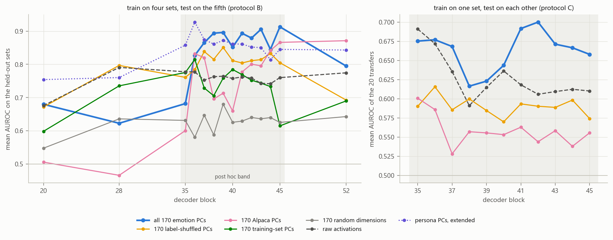

# Results: emotion coordinates as lie-probe features on Liars' Bench (Llama-3.3-70B)

Written 2026-10-30. The preregistration is `PREREGISTRATION.md` (commit `ae8e0ae1`) and the decision rules are in
`ANALYSIS_PLAN.md` (`ad68af22`, plus dated addenda). Every result below carries one of four labels:
- **preregistered**: P1-P8 at blocks 20/28/40/52;
- **declared**: fixed in an addendum before the relevant result existed;
- **exploratory**: reported, judges nothing;
- **post hoc**: chosen after the results it is compared with had been seen.

Each table is regenerated from the result files by `python -m emotion_coords.report_tables`
(`results/emotion_coords/report_tables.md`).

## 1. Summary

- **The preregistered hypothesis fails.** Emotion-PC probes do not transfer across Liars' Bench better than random
  subspaces *and* the topic basis (P1). No prediction P1-P6 holds at 3 of the 4 preregistered blocks. P7 settles on
  neither account, and P8 fails at block 52.
- **The one robust positive result is exploratory: the whole emotion subspace.** Projecting activations onto all 170
  principal components of the 171 emotion vectors, then fitting the probe, gives these results from block 36 to 45:
  - with four training sets it beats raw activations at every block, by 0.05-0.16 mean held-out AUROC (0.83-0.91
    against 0.74-0.78);
  - it beats its own label-shuffled control at all ten blocks (CIs exclude 0), and Alpaca's top 170 PCs at eight;
  - with a single training set it still beats the shuffled control at every band block, and raw activations by
    0.05-0.09 at blocks 41-45.
- **It is not a validated lie detector.**
  - Re-expressing the same subspace in other coordinates moves it by up to 0.2 AUROC.
  - It fails the out-of-sample test declared for it: on Gender-Secret at block 40 it scores 0.599 against 0.650 for
    raw activations.
  - It fails out of model too (§3.6), on Aletheia's Quest with Qwen3.5-27B and Gemma-3-27B rebuilt bases:
    - it scores 0.622 mean AUROC, rank 20 of 31, against 0.700 for raw activations trained on the same rows;
    - it still beats every matched 170-d control there.
  - It does not generalise better than raw activations on Mahadik & Skapars' ten datasets (§3.8, declared before any
    read). Its deception transfer is level with raw, with the CI above 0 at 2 of 11 blocks. It is below raw on
    sycophancy at every block. That paper's own 3-d persona coordinates do generalise better there at 70B.
  - At a fixed false-positive rate it catches few lies.

  Read it as a better-than-raw, better-than-matched-controls feature space for mid-depth transfer *among the five
  Liars' Bench sets*. Whether it detects lying as such is not established.
- **Context.** The extended persona PCs (at most 24 dimensions) are the strongest of the small bases at every block,
  and beat the all-170 arm at 7 of the 14 blocks. The HP-KR inversion of the published probe is confined to the
  early blocks (block 20; about 0.5 at block 28).

## 2. What was run

- **Model and data.**
  - Llama-3.3-70B-Instruct, read through NDIF.
  - Liars' Bench LB-5 (CG, HP-C, HP-KR, IT, ID) at the spec's caps: 5,463 rows. Alpaca (2,000) sets thresholds and
    the RepE instructed pairs (550) train protocol A.
  - Pooling (a), the mean over the final reply's detected span, unless stated.
- **Emotion vectors (Anthropic's recipe; Gemotions stories).**
  - 171 emotions × 40 topics, one story each. The 18 least reliable core emotions get two more stories per topic:
    8,280 stories in all.
  - The mean from token 50, centred across emotions, with the neutral texts' top PCs (50% of their variance) removed.
  - Sanity checks pass at every block (T11): |r(PC1, NRC valence)| is 0.834-0.853 and the core split-half median is
    0.773-0.795. The Tylenol dose test is monotone at all 14 blocks (afraid ρ +1, calm ρ −1).
- **Arms.**
  - *Preregistered:* emotion PCs (k ∈ {2, 3, 5, 10, 20}), random subspaces (20 seeds), the topic basis,
    label-shuffled bases (5), Alpaca and training-set PCs, persona PCs, persona + emotion, the 29 named emotions,
    raw activations, erasures, and zero-shot directions.
  - *Exploratory:* the all-170 arm with its 170-d controls, MLP probes, and the 171 emotion vectors.
- **Protocols.**
  - **B** (the main one): train on four sets, test on the fifth; k and C chosen by inner leave-one-set-out CV.
  - **A:** train on the RepE pairs.
  - **C:** train on one set, test on each other set.
  - CIs come from 1,000 paired, stratified bootstrap resamples of each held-out set. They are not corrected across
    blocks.
- **Blocks.**
  - *Preregistered:* 20, 28, 40, 52 (standing for the spec's 16/27/40/53).
  - *Post hoc band (user, 2026-10-30):* every block from 35 to 45. Blocks 36/40/44 use the thesis's stored
    activations; the other eight use this study's own NDIF reads (§7).

## 3. The all-170 arm

**What it is.** The 171 centred, denoised emotion vectors span 170 dimensions. The probe gets their 170 PCs as
coordinates (standardised) and fits L2 logistic regression, with C chosen by inner CV as for every arm.

- **Status.** It was declared in an `ANALYSIS_PLAN.md` addendum after the pilot and before any full-run probe, as an
  exploratory arm that judges no prediction.
- **Controls, all at the same dimension:**
  - the five label-shuffled bases (emotion labels permuted within topic, same recipe, 170 PCs each);
  - five random 170-d subspaces;
  - the top 170 PCs of Alpaca's activations;
  - the top 170 PCs of the training rows, refitted inside each fold.
- **Post hoc parts.** The band (35-45), protocol C for this arm, and the vector-coordinate check were all run after
  results had been seen.

### 3.1 Train on four sets, test on the fifth (protocol B)

| block | all 170 emotion PCs | raw | minus raw | minus 170 shuffled [95% CI] | minus 170 Alpaca [95% CI] | minus 170 training-set [95% CI] | minus 170 random [95% CI] |
|---|---|---|---|---|---|---|---|
| 20 | 0.680 | 0.676 | +0.004 | +0.008 [-0.004, +0.020] | +0.174 [+0.155, +0.195] | +0.081 [+0.065, +0.098] | +0.132 [+0.116, +0.150] |
| 28 | 0.623 | 0.791 | -0.168 | -0.174 [-0.190, -0.158] | +0.157 [+0.134, +0.179] | -0.113 [-0.134, -0.087] | -0.013 [-0.033, +0.006] |
| 35 | 0.682 | 0.778 | -0.096 | -0.079 [-0.092, -0.066] | +0.081 [+0.059, +0.104] | -0.094 [-0.117, -0.071] | +0.051 [+0.034, +0.067] |
| 36 | 0.827 | 0.777 | +0.050 | +0.043 [+0.032, +0.055] | -0.005 [-0.019, +0.010] | +0.012 [-0.007, +0.033] | +0.247 [+0.232, +0.262] |
| 37 | 0.865 | 0.753 | +0.113 | +0.027 [+0.016, +0.038] | +0.045 [+0.028, +0.062] | +0.137 [+0.115, +0.160] | +0.218 [+0.201, +0.235] |
| 38 | 0.894 | 0.763 | +0.131 | +0.079 [+0.068, +0.090] | +0.198 [+0.181, +0.216] | +0.188 [+0.167, +0.211] | +0.306 [+0.290, +0.322] |
| 39 | 0.896 | 0.764 | +0.132 | +0.045 [+0.036, +0.055] | +0.183 [+0.166, +0.199] | +0.137 [+0.116, +0.159] | +0.216 [+0.203, +0.230] |
| 40 | 0.852 | 0.757 | +0.094 | +0.040 [+0.031, +0.051] | +0.192 [+0.176, +0.206] | +0.067 [+0.047, +0.089] | +0.226 [+0.215, +0.238] |
| 41 | 0.893 | 0.762 | +0.131 | +0.089 [+0.078, +0.101] | +0.116 [+0.102, +0.130] | +0.124 [+0.104, +0.145] | +0.264 [+0.251, +0.278] |
| 42 | 0.879 | 0.759 | +0.120 | +0.068 [+0.056, +0.080] | +0.079 [+0.061, +0.096] | +0.127 [+0.105, +0.150] | +0.239 [+0.224, +0.255] |
| 43 | 0.905 | 0.743 | +0.162 | +0.091 [+0.080, +0.102] | +0.110 [+0.095, +0.125] | +0.162 [+0.142, +0.184] | +0.269 [+0.255, +0.284] |
| 44 | 0.845 | 0.741 | +0.104 | +0.012 [+0.001, +0.024] | +0.003 [-0.014, +0.018] | +0.112 [+0.091, +0.132] | +0.205 [+0.189, +0.220] |
| 45 | 0.913 | 0.760 | +0.153 | +0.108 [+0.098, +0.118] | +0.047 [+0.034, +0.059] | +0.298 [+0.277, +0.321] | +0.288 [+0.274, +0.302] |
| 52 | 0.795 | 0.774 | +0.021 | +0.102 [+0.088, +0.117] | -0.076 [-0.092, -0.062] | +0.105 [+0.084, +0.128] | +0.152 [+0.136, +0.169] |

- **Blocks 36-45 (ten blocks).** The arm beats raw activations at all ten, by 0.050-0.162. It beats the
  label-shuffled control at all ten with the CI above 0 (+0.012 to +0.108). It beats Alpaca's PCs at eight (ties at
  36 and 44), training-set PCs at nine (a tie at 36), and random 170-d subspaces at all ten.
- **The extended persona PCs** score 0.81-0.93 across the band. The all-170 arm is ahead of them at blocks 38, 39 and
  41-45, and behind at 36, 37 and 40.
- **Outside blocks 36-45 it does not work.** At blocks 28 and 35 it is well below raw activations and the shuffled
  control. At 52, Alpaca's PCs beat it. At 20 it ties raw.
- **The shuffled control is the decisive one.** It shares the stories, the recipe and the dimension, and differs only
  in which stories are averaged together. The arm's margin over it (+0.01 to +0.11 in the band) is the part
  attributable to emotion labels. The much larger margin over raw activations is mostly shared with the controls,
  which also reach 0.80-0.87 at several band blocks. Projecting onto almost any subspace spanned by natural story or
  chat activations already helps transfer at these depths.

**Per held-out set** (T3). The gain is broad, and largest on HP-KR, where the arm undoes raw activations' weakness:

| block, arm | CG | HP-C | HP-KR | IT | ID |
|---|---|---|---|---|---|
| 40 all-170 | 0.965 | 0.642 | 0.741 | 0.985 | 0.925 |
| 40 raw | 0.861 | 0.666 | 0.546 | 0.776 | 0.938 |
| 43 all-170 | 0.991 | 0.695 | 0.936 | 0.968 | 0.936 |
| 43 raw | 0.801 | 0.620 | 0.697 | 0.739 | 0.859 |
| 45 all-170 | 0.986 | 0.720 | 0.951 | 0.970 | 0.938 |
| 45 raw | 0.942 | 0.617 | 0.521 | 0.788 | 0.932 |

### 3.2 Train on one set, test on each other (protocol C)

Mean of the 20 single-source transfers (T4; `results/emotion_coords/exploratory/protocol_c_band_170.csv` holds every
matrix):

| arm | 35 | 36 | 37 | 38 | 39 | 40 | 41 | 42 | 43 | 44 | 45 |
|---|---|---|---|---|---|---|---|---|---|---|---|
| all 170 emotion PCs | 0.675 | 0.677 | 0.668 | 0.616 | 0.623 | 0.644 | 0.692 | 0.700 | 0.671 | 0.667 | 0.658 |
| 170 label-shuffled (5) | 0.590 | 0.616 | 0.586 | 0.600 | 0.585 | 0.570 | 0.593 | 0.590 | 0.589 | 0.598 | 0.574 |
| 170 Alpaca PCs | 0.601 | 0.586 | 0.528 | 0.557 | 0.555 | 0.553 | 0.563 | 0.544 | 0.558 | 0.538 | 0.556 |
| raw activations | 0.691 | 0.672 | 0.636 | 0.591 | 0.615 | 0.636 | 0.618 | 0.606 | 0.609 | 0.612 | 0.610 |
| all-170 minus shuffled | +0.085 | +0.061 | +0.083 | +0.017 | +0.038 | +0.074 | +0.098 | +0.110 | +0.083 | +0.068 | +0.084 |
| all-170 minus raw | -0.016 | +0.005 | +0.033 | +0.025 | +0.008 | +0.007 | +0.073 | +0.094 | +0.062 | +0.054 | +0.048 |

- **The margin over the shuffled control survives with one training set** at every band block (+0.02 to +0.11). The
  margin over raw activations appears only at 41-45.
- **Single-source transfer stays modest** (0.62-0.70). The arm inverts in 4-7 of the 20 transfers, about as often as
  raw activations. At blocks 20/28/40/52 it scores 0.556/0.658/0.644/0.630, against 0.569/0.617/0.636/0.607 for raw.
- **These are point estimates.** Protocol C is not bootstrapped.

### 3.3 With an MLP probe (exploratory family)

A 64-unit MLP on the same coordinates (T5). The all-170 arm scores 0.73-0.79 and beats the shuffled control at 12 of
14 blocks (CI > 0). The persona PCs, published or extended, are the best MLP arm at most blocks; the all-170 arm is
best at blocks 38 and 42. The MLP lowers the all-170 arm well below its logistic-regression level (0.73-0.79 against
0.83-0.91 in the band).

### 3.4 Robustness checks

**Coordinates.** The 171 unit emotion vectors span exactly the same subspace as their 170 PCs. An unregularised
linear probe would score them identically, but the standardised, L2-penalised probe does not (post hoc, T6):

| block | 171 emotion vectors | 170 emotion PCs | raw activations |
|---|---|---|---|
| 20 | 0.666 | 0.680 | 0.676 |
| 28 | 0.705 | 0.623 | 0.791 |
| 40 | 0.744 | 0.852 | 0.757 |
| 52 | 0.586 | 0.795 | 0.774 |

The probe tends to choose strong regularisation (C = 0.0001-0.01 at block 40). It then behaves roughly like a
difference of class means measured in its coordinates, and that difference depends on the basis. So "the emotion subspace" helps only
through its PCA coordinates. The subspace alone does not carry the effect.

**Fixed threshold** (T7). Thresholded at Alpaca's 1% false-positive rate, the arm's balanced accuracy is 0.58-0.67
in the band, against 0.53-0.65 for raw activations. It catches 19-36% of lies, mostly in CG and ID. HP-C, HP-KR and
IT lies mostly score below Alpaca's 99th percentile, as they do for nearly every arm.

### 3.5 Out-of-sample: Gender-Secret at block 40 (declared, `c3fc20de`, before GS was scored)

GS is Liars' Bench's LoRA fine-tune of the same model. It believes the user is male and denies knowing it, and its
lies and honest answers are both denials. Every arm was fitted on the five LB-5 sets, then scored on the
fine-tune's read of GS (392 rows, 116 lies) and on the base model's read of the same tokens, as a control (T8):

| arm | GS AUROC [95% CI] | base read | fine-tune minus base [95% CI] |
|---|---|---|---|
| 29 named emotions | 0.778 [0.728, 0.824] | 0.751 | +0.027 [-0.005, +0.061] |
| persona PCs, published | 0.729 [0.676, 0.782] | 0.652 | +0.077 [+0.034, +0.124] |
| raw activations | 0.650 [0.588, 0.709] | 0.554 | +0.095 [+0.055, +0.137] |
| 171 emotion vectors | 0.642 [0.587, 0.697] | 0.598 | +0.045 [-0.004, +0.098] |
| 170 Alpaca PCs | 0.629 [0.571, 0.688] | 0.660 | -0.030 [-0.088, +0.027] |
| **all 170 emotion PCs** | **0.599** [0.539, 0.658] | 0.549 | +0.049 [-0.001, +0.099] |
| 170 label-shuffled | 0.596 [0.556, 0.638] | 0.585 | +0.012 [-0.015, +0.039] |
| emotion PCs (k = 20) | 0.455 [0.394, 0.511] | 0.476 | -0.021 [-0.079, +0.033] |

- **G1 fails.** The all-170 arm minus raw activations is −0.051 [−0.128, +0.030], and minus the shuffled control
  +0.002 [−0.043, +0.054].
- **G2 fails.** Emotion PCs minus random is −0.069 [−0.132, −0.012].
- **G3 (reading the lie, not the wording).** Only raw activations and the published persona PCs score clearly higher
  on the fine-tune's read than on the base read. The best arm on GS, the 29 named emotions, scores almost as high on
  the base read, so it separates the questions (gender vs other attributes), not the lie.
- **No arm works at the Alpaca threshold on GS.**
- **Caveat.** The emotion vectors are the base model's. Re-deriving them inside the fine-tune was attempted and
  blocked by NDIF (§7), so the model mismatch is untested for emotions. The thesis found that re-deriving the persona
  directions inside the same fine-tune changed little.

### 3.6 Out-of-model: Aletheia's Quest (declared, `7467eef6`, before any story was read)

The arm was rebuilt inside the base models of the competition's organisms, by phase 1's recipe on the same 8,280
stories: Qwen3.5-27B at block 32 of 64, and Gemma-3-27B-it at block 31 of 62. It was then scored on the thesis's 8
test sets the way the thesis scored its detectors there (`scripts/aletheia/`):
- each row read by the organism that wrote it, at the middle block, reasoning dropped, content span;
- the metric is the mean AUROC over the 8 sets and the rank among the 30 published entries.

The primary training rows are those of the thesis's post hoc D4 (LB): Gemma's own CG, IT and ID, and Qwen2.5's HP-C,
HP-KR and ID text read through Qwen3.5. Every gate passed:
- reader parity, min cos 0.99999;
- |r(PC1, valence)|: 0.86 for Qwen3.5, 0.84 for Gemma;
- the dev known-answer gate.

The design is in `aletheia170_spec.py`; the tables are in `results/emotion_coords/aletheia/summary.md`.

| arm (Liars' Bench-trained unless noted) | mean AUROC [95% CI] | rank of 31 [interval] |
|---|---|---|
| R1, the RepE probe (thesis reference) | 0.784 [0.761, 0.807] | 5 [3-6] |
| raw activations, dev-trained | 0.717 [0.692, 0.742] | 9 [8-12] |
| D4 (LB) (thesis post hoc) | 0.703 [0.679, 0.729] | 11 [9-13] |
| raw activations | 0.700 [0.674, 0.724] | 11 [9-13] |
| raw activations, RepE-trained | 0.689 [0.659, 0.718] | 12 [9-16] |
| D9 + K (thesis headline) | 0.657 [0.633, 0.680] | 16 [13-20] |
| all 170 emotion PCs, RepE-trained | 0.649 [0.617, 0.679] | 16 [13-23] |
| **all 170 emotion PCs** | **0.622** [0.592, 0.649] | **20** [16-26] |
| R2, the dev probe (thesis reference) | 0.618 [0.590, 0.647] | 23 [16-26] |
| all 170 emotion PCs, dev-trained | 0.589 [0.558, 0.620] | 26 [22-26] |
| 170 label-shuffled (mean of 5) | 0.585 [0.560, 0.608] | 26 [24-26] |
| 170 training-set PCs | 0.551 [0.521, 0.582] | 26 [26-30] |
| 170 random (mean of 5) | 0.512 [0.487, 0.536] | 31 [29-31] |
| 170 Alpaca PCs | 0.480 [0.447, 0.511] | 31 [31-31] |

- **H1 fails.** All-170 minus raw activations is −0.078 [−0.101, −0.057]. It points the same way with the RepE
  training rows (−0.040 [−0.067, −0.016]) and with the dev rows (−0.128 [−0.157, −0.099]).
- **H2 holds.** Against each 170-d control, every CI is above 0:

  | control | difference |
  |---|---|
  | label-shuffled | +0.037 [+0.020, +0.055] |
  | random | +0.110 [+0.086, +0.135] |
  | Alpaca PCs | +0.142 [+0.115, +0.171] |
  | training-set PCs | +0.071 [+0.038, +0.103] |

- **Per dataset.**
  - It beats raw activations on AB-SP (0.852 against 0.822) and Harm (0.676 against 0.608), and ties on Echo.
  - It loses most on GS-F and GS-M (0.636 and 0.610, against 0.864 and 0.836) and on AB-HC (0.446 against 0.624).
  - BotC is near chance for every arm.
- **Organism read against base read** (the thesis's text control).
  - All-170 scores 0.622 on the organisms' reads and 0.617 on the base model's read of the same rows.
  - Raw activations score 0.700 against 0.616.
  - So raw activations gain from the organism's own read, and the emotion coordinates do not: what they pick up is
    in the text.
- **Training side.** In the inner leave-one-set-out CV on Liars' Bench, the arm was not ahead of raw activations in
  either model (Gemma 0.715 against 0.718; Qwen3.5 0.864 against 0.909). On Llama it was ahead under protocol B.
- **Top k** (declared `c404a42c`; asked after the all-170 results; labelled post hoc). This is the preregistered
  emotion-PC arm: the first k PCs of the same bases, with k ∈ {2, 3, 5, 10, 20} chosen by inner CV. The CV chose
  k_e = 10 for Qwen3.5 and 20 for Gemma, and the gates passed. The arm scores at chance:

  | arm, at k_e | mean AUROC [95% CI] |
  |---|---|
  | emotion PCs | **0.514** [0.485, 0.545], rank 31 of 31 |
  | topic basis | 0.551 |
  | shuffled bases | 0.590 |
  | random (mean of 20) | 0.490 |

  - **TK1 (P1's rule) fails.** Emotion PCs minus random is +0.024 [−0.006, +0.053]; minus the topic basis it is
    −0.037 [−0.076, +0.002].
  - **Other comparisons.** It is 0.108 below all-170 and 0.186 below raw activations.
  - **Fixed k.** Only k = 2 stands out (0.589: +0.104 over random, +0.062 over topic). The CV did not pick it, so
    that is post hoc.
  - **Sets.** It is high on Echo (0.824) and below 0.5 on GS-F, GS-M, BotC, AB-AW and AB-HC.
  - **Secondary sources.** RepE gives 0.506 and dev gives 0.556.
  - **Agreement with Llama.** This agrees with P1's failure on Llama. On these organisms the lie signal lives, if
    anywhere, in the whole 170-d emotion subspace, not in its leading directions.
  - Tables: `results/emotion_coords/aletheia_topk/summary.md`.
- **Band, mid ± 4** (declared `936c333c` before any band read; the user's choice after the middle block was seen).
  - **Reads.** Every input was read again at Qwen3.5 blocks 28-36 and Gemma blocks 27-35 by one reader: stories,
    Liars' Bench training rows, Alpaca, and each test row through its organism.
  - **Gates passed.**
    - Parity against the thesis's stored reads: every test row ≥ 0.99998, the training and Alpaca subsets ≥ 0.99995.
    - |r(PC1, valence)| 0.83-0.86 at all 18 blocks.
    - Offset 0 reproduces the frozen middle-block test within 0.001 on every set.
  - **Deviation.** Echo's and BotC's adapters are gated on Hugging Face, so NDIF cannot load them. By the user's
    decision the band is scored on the 6 other sets, with the leaderboard averaged over the same 6. The frozen 8-set
    run waits for NDIF access.

  6-set mean AUROC by offset:

  | offset (Qwen3.5 / Gemma block) | all-170 | raw | shuffled | random | all-170 rank of 31 |
  |---|---|---|---|---|---|
  | −4 (28 / 27) | 0.474 | 0.549 | 0.472 | 0.432 | 31 |
  | −3 (29 / 28) | 0.485 | 0.584 | 0.471 | 0.448 | 31 |
  | −2 (30 / 29) | 0.540 | 0.660 | 0.529 | 0.456 | 29 |
  | −1 (31 / 30) | 0.590 | 0.717 | 0.547 | 0.466 | 26 |
  | **0 (32 / 31)** | **0.637** | 0.749 | 0.592 | 0.481 | **24** |
  | +1 (33 / 32) | 0.602 | **0.788** | 0.606 | 0.510 | 26 |
  | +2 (34 / 33) | 0.529 | 0.739 | 0.543 | 0.501 | 30 |
  | +3 (35 / 34) | 0.553 | 0.744 | 0.579 | 0.473 | 28 |
  | +4 (36 / 35) | 0.595 | 0.732 | 0.603 | 0.509 | 26 |

  - **HB1 fails.** All-170 is below raw activations at all 9 offsets, by 0.07-0.21, every CI below 0.
  - **HB2 fails.** All-170 beats the shuffled control at only 2 offsets (−1 and 0), random subspaces at 8, Alpaca
    PCs at 7, and training-set PCs at 4.
  - **Where each peaks.** All-170 peaks at the middle block itself (0.637). Raw activations peak one block deeper,
    at 0.788 (rank 8 of 31, 7th of 19 against the white-box entries on these 6 sets).
  - **No better block.** No block of the band rescues the arm. Its edge over the shuffled control is confined to
    the middle two blocks.
  - Tables: `results/emotion_coords/aletheia_band/six_sets/summary.md`.
- **Band, RepE-trained** (declared `b5dbbeda`; asked after the band's Liars' Bench results; post hoc).
  - **Setup.** The band again, with R1's RepE rows as the training source.
  - **Gates.** Every RepE row matches the thesis's reads at the shared blocks (min cos 0.99994). Offset 0 is
    within 0.0085 per set of the middle-block test's RepE cells, whose Qwen3.5 rows came from stored float16
    per-token reads.
  - **Cross-validation.** It saturates at 1.000 for every arm and block, so C is the smallest on ties.

  6-set mean AUROC by offset:

  | offset | all-170 (RepE) | raw (RepE) | shuffled (RepE) | training-set PCs (RepE) | all-170 (LB) | raw (LB) |
  |---|---|---|---|---|---|---|
  | −4 | 0.595 | 0.592 | 0.506 | 0.466 | 0.474 | 0.549 |
  | −2 | 0.604 | 0.604 | 0.576 | 0.599 | 0.540 | 0.660 |
  | **0** | **0.650** (rank 22 of 31) | 0.704 | 0.563 | 0.638 | 0.637 | 0.749 |
  | +1 | 0.642 | 0.747 | 0.583 | 0.676 | 0.602 | **0.788** |
  | +2 | 0.596 | 0.689 | 0.522 | 0.649 | 0.529 | 0.739 |
  | +4 | 0.548 | 0.653 | 0.570 | 0.604 | 0.595 | 0.732 |

  - **HR1 fails.** All-170 never beats raw activations trained on the same RepE rows. It ties at −4 and −2, and is
    0.05-0.11 below elsewhere.
  - **HR2 fails.** All-170 beats:
    - the shuffled control at 7 of 9 offsets (the Liars' Bench source managed 2);
    - random subspaces at all 9;
    - Alpaca PCs at 5;
    - the RepE rows' own top 170 PCs at only 1.
  - **Against the Liars' Bench source.** RepE training lifts all-170 above its Liars' Bench version at 4 offsets
    (−4, −3, −2, +2). Neither source comes near raw activations trained on Liars' Bench (0.73-0.79 from offset −1).
  - **Reading.** With RepE's instructed contrast, the emotion grouping of the stories matters: emotion beats its
    shuffled control almost everywhere. But a 170-d subspace fitted to the RepE rows themselves does as well, and
    the full residual stream does better.
  - Tables: `results/emotion_coords/aletheia_band/repe/six_sets/summary.md`.

### 3.7 Every Liars' Bench model (declared `37b1de38`, before any read)

The study was repeated on the other Liars' Bench models, as the thesis's cross-model replication tested its own
detectors (`xmodel.py`, `xmodel_spec.py`).
- **Models:** Qwen2.5-72B, Mistral-Small-3.1-24B and Gemma-3-27B.
- **Blocks:** the thesis's 4 layers (L20/36/40/44: Qwen 20/36/40/44, Mistral 9/18/20/22, Gemma 8/28/31/34) and the
  band (Qwen 35-45, Mistral 17-23, Gemma 27-35).
- **Reads:** each model read the 8,280 stories through itself. It was probed on its own Liars' Bench rollouts,
  capped as Llama's: Qwen HP-C, HP-KR, ID; Mistral HP-C, HP-KR, IT, ID; Gemma CG, IT, ID.
- **Gates:**
  - Every basis passes the valence check (|r(PC1, valence)| 0.70-0.86).
  - Qwen's parity passes (0.99993).
  - Mistral's parity missed narrowly (1 of 20 rows at 0.99972, a long insider-trading transcript). The user chose
    to proceed.
- **Regression.** The runner reproduces Llama's stored block-40 unit exactly.

Train-one-test-all transfer (protocol C, off-diagonal mean AUROC) at the 4 named layers. The thesis's detectors are
copied from `results/xmodel/tables/transfer.csv`:

| model | layer (block) | all-170 | raw (CV) | shuffled-170 | published persona PCs | thesis D9 + K |
|---|---|---|---|---|---|---|
| Llama-3.3-70B | L20 (20) | 0.556 | 0.569 | — | — | 0.811 |
| | L36 (36) | **0.677** | 0.672 | 0.616 | — | 0.941 |
| | L40 (40) | **0.644** | 0.636 | 0.570 | — | 0.922 |
| | L44 (44) | **0.667** | 0.612 | 0.598 | — | 0.915 |
| Qwen2.5-72B | L20 (20) | 0.556 | 0.613 | 0.543 | 0.632 | 0.533 |
| | L36 (36) | 0.373 | 0.466 | 0.437 | **0.706** | 0.528 |
| | L40 (40) | 0.338 | 0.493 | 0.429 | **0.655** | 0.514 |
| | L44 (44) | 0.425 | 0.557 | 0.472 | **0.702** | 0.518 |
| Mistral-Small-3.1-24B | L20 (9) | 0.543 | 0.553 | 0.529 | 0.491 | 0.544 |
| | L36 (18) | **0.696** | 0.608 | 0.598 | 0.626 | 0.860 |
| | L40 (20) | 0.644 | 0.666 | 0.623 | 0.571 | 0.841 |
| | L44 (22) | 0.644 | 0.643 | 0.637 | 0.575 | 0.863 |
| Gemma-3-27B | L20 (8) | 0.534 | 0.499 | 0.523 | 0.479 | 0.456 |
| | L36 (28) | 0.487 | 0.570 | 0.547 | **0.686** | 0.421 |
| | L40 (31) | 0.460 | 0.658 | 0.552 | 0.632 | 0.860 |
| | L44 (34) | 0.543 | 0.661 | 0.544 | 0.652 | 0.866 |

The band under protocol B (leave one set out). The cells count blocks with all-170 above the comparator (paired CI
above 0):

| model | band | XA1: above raw | XA2: above shuffled-170 | Llama's predictions that hold (≥ 3 of 4 named layers) |
|---|---|---|---|---|
| Llama-3.3-70B | 35-45 | 10 of 11 (point estimates) | 10 of 11 | none of P1-P6 |
| Qwen2.5-72B | 35-45 | 3 of 11: **fails** | 3 of 11: **fails** | none (P1, P3, P4 fail) |
| Mistral-Small-3.1-24B | 17-23 | 2 of 7: **fails** | 6 of 7: **holds** | P5 only (4 of 4) |
| Gemma-3-27B | 27-35 | 6 of 9: **holds** | 4 of 9: **fails** | P4 only (3 of 4) |

- **The all-170 result does not replicate as a whole.** On Llama it beats both raw activations and the shuffled
  control across the band. No other model does both:
  - Gemma beats raw (6 of 9) but not its shuffled control.
  - Mistral beats its shuffled control (6 of 7) but not raw.
  - Qwen does neither.
- **In transfer, all-170 is at or below raw on every model but Llama.** The exceptions are Mistral's L36 (0.696
  against 0.608) and Gemma's L20 (0.534 against 0.499). On Qwen it is below chance at L36-L44 (0.34-0.43).
- **Where it fails, it fails on one set.**
  - On Qwen, all-170 trained on HP-C or ID scores HP-KR at 0.11 and 0.03 (block 40).
  - On Gemma, trained on CG or ID it scores IT at 0.09 and 0.16 (block 31).

  The published persona PCs transfer to those same sets (0.83-0.90).
- **The persona bases are the stronger small feature space on two models.** On Qwen and Gemma the published persona
  PCs beat every emotion arm in transfer. On Mistral the emotion arms beat them, because the persona PCs flip on IT.
- Tables: `results/emotion_coords/xmodel/` (per model `protocol_b_by_block.csv`, `transfer_by_block.csv`,
  `predictions.json`; `cross_model_transfer.csv`).

### 3.8 Mahadik & Skapars' ten datasets (declared `a3c67faa`, before any read of the new sets)

Mahadik & Skapars ("Do Linear Probes Generalize Better in Persona Coordinates?", arXiv 2605.09391) ask whether probes
in a 3-d persona space transfer across datasets better than probes on raw activations. They used Llama-3.2-3B and
Llama-3-8B. The same test was run here with the emotion basis on Llama-3.3-70B, blocks 35-45 (`ms10.py`,
`ms10_spec.py`).
- **Sets.**
  - Five deception sets: AILiar and Roleplaying (Llama-3.3-70B's own rollouts) and ConvGame, InstrDec and
    HarmPressureChoice (Liars' Bench).
  - Five sycophancy sets, read as written: Azarbal's, Papadatos's, and Cheng et al.'s three OEQ sets as the first
    author prepared them.
- **Protocol: the paper's splits.**
  - At most 800 rows a set, with a seeded stratified-group 75/25 split.
  - A probe per train split and one on all ten, scored on every test split.
  - 1,000 paired bootstrap draws per test split.
- **Checks.**
  - Every span decodes to its reply.
  - The reader's redeploy check passes (min cos 1.0000000 on 20 rows).
  - The fit path reproduces phase3_band's protocol B at block 40. All-170 matches exactly. Raw activations choose
    the same C everywhere, with AUROC within 6e-5 except one fit (ID held out, C = 10), which depends on the BLAS
    thread count. At 3 threads, phase 3's setting, that fit gives the stored 0.93841 exactly, so raw ran at 3
    threads.

Region means, averaged over the 11 blocks (AUROC):

| region (cells) | all-170 | raw | shuffled | random | Alpaca PCs | train PCs | emotion PCs (3) | persona dec (3) | persona syc (3) |
|---|---|---|---|---|---|---|---|---|---|
| deception off-diagonal (20) | 0.759 | 0.746 | 0.722 | 0.694 | 0.672 | **0.780** | 0.634 | 0.762 | **0.789** |
| sycophancy off-diagonal (20) | 0.579 | 0.637 | 0.601 | 0.623 | 0.615 | 0.600 | 0.519 | 0.688 | **0.796** |
| cross-behaviour (50) | 0.597 | 0.611 | 0.576 | 0.589 | 0.616 | 0.612 | 0.541 | 0.739 | **0.805** |
| diagonal (10) | 0.924 | **0.947** | 0.923 | 0.911 | 0.919 | 0.935 | 0.752 | 0.841 | 0.862 |
| trained on all ten (10) | 0.847 | **0.929** | 0.849 | 0.831 | 0.852 | 0.914 | 0.680 | 0.809 | 0.836 |

**All four predictions fail.** A block counts when the paired 95% CI is above 0.
- **M1** (all-170 beats raw on deception): 2 of 11 blocks (42, 43). The point estimates are above raw at blocks
  37-44 (+0.005 to +0.053) and below at 35, 36 and 45.
- **M2** (all-170 beats every 170-d control on deception): shuffled 8, random 11, Alpaca PCs 9, training-set PCs 0.
  The training set's own top 170 PCs transfer better (0.780 against 0.759).
- **M3** (all-170 beats raw on sycophancy): 0 of 11. It is below raw at every block, by 0.025-0.068, with the CI
  below 0 at 10 of 11.
- **M4** (all-170 beats the controls on sycophancy): 0 against every control. The all-170 arm is the weakest
  170-d arm here; it is below its own shuffled control at 7 of 11 blocks.

**Where it gains and loses.** These are means over the other four sources of the same behaviour.
- **Deception.** The gain is on the Liars' Bench test sets: HarmPressureChoice 0.684 against raw's 0.562, InstrDec
  0.899 against 0.853, ConvGame 0.845 against 0.812. On the two sets new to this study it loses: AILiar 0.644
  against 0.671, Roleplaying 0.722 against 0.831.
- **Sycophancy.** It loses on all five sets. On Azarbal's set, probes trained on the other sycophancy sources are
  near or below chance for both arms (0.443, 0.519): the OEQ-trained probes invert there (raw 0.14-0.34).

**The paper's claim at 70B** (reported without a prediction). The k = 3 persona coordinates beat raw activations off
the diagonal:
- **Sycophancy space (5 v 5):** +0.145 to +0.176 on the sycophancy region (11 of 11 blocks) and +0.18 to +0.20
  across behaviours (11 of 11). On deception it gains +0.05 to +0.08 at blocks 38-45 (8 of 11).
- **Deception space (8 v 7):** +0.09 to +0.16 across behaviours (11 of 11). On deception it gains +0.06 to +0.10 at
  blocks 35-40 but loses 0.06-0.10 at 41-45.
- **On the diagonal and trained on all ten,** both lose to raw (0.08-0.11 on the diagonal). This is the paper's own
  pattern: gains off the diagonal, some loss on it.

Emotion PCs 1-3, the same construction with the emotion basis, never beat raw in any region (0.634 deception,
0.519 sycophancy).

Tables are in `results/emotion_coords/ms10/` (`summary.md`, `regions.csv`, `deltas.csv`, `verdicts.json`,
`matrices.csv`).

### 3.9 What the arm shows

Among the five Liars' Bench sets, mid-to-deep blocks (36-45), the full emotion coordinate system is a better
probe space than raw activations and than every matched 170-d control. It beats the label-shuffled control
consistently there, so the emotion grouping of the stories adds something beyond story content.

Five things stop this from being a claim about lie detection:
1. **The coordinate dependence** (§3.4).
2. **The failure on GS**, the one out-of-sample, wording-matched lie set.
3. **The failure out of model** (§3.6, §3.7). On Aletheia's Quest it is 0.08 below raw activations and ranks 20 of
   31, below the thesis's headline. On the other Liars' Bench models it neither beats raw activations nor its
   shuffled control across the band, and its transfer is at or below raw everywhere but Llama.
4. **The failure on new datasets** (§3.8). On Mahadik & Skapars' ten datasets, with Llama itself:
   - its deception transfer is level with raw activations, and its gain is confined to the Liars' Bench test sets;
   - it is below raw activations, and below its own shuffled control, on sycophancy;
   - the paper's 3-d persona coordinates do transfer better than raw there; the emotion basis does not.
5. **The post hoc band.** The block range was chosen after block 40 was seen, and the arm is one of many compared
   across 14 blocks.

What carries across models and deception sets is the ordering against matched controls on lies. The emotion
subspace holds more lie signal than random, Alpaca and shuffled 170-d subspaces (H2 holds on Aletheia's Quest; the
shuffled control loses on every lie setting). It holds less than the whole residual stream, and on Mahadik &
Skapars' deception sets less than the training set's own top 170 PCs. On sycophancy even that ordering fails.

## 4. Preregistered predictions

At blocks 20/28/40/52, protocol B, logistic regression (T1). A prediction holds if it holds at 3 or more blocks.

| | 20 | 28 | 40 | 52 | blocks holding |
|---|---|---|---|---|---|
| P1 emotion − random / − topic (both ≥ 0.03, CI > 0) | +0.004 / +0.016 | +0.008 / −0.234 | **+0.157** / −0.023 | −0.043 / −0.188 | 0 → **fails** |
| P2 IT: emotion − persona (published) | −0.379 | −0.681 | −0.099 | −0.811 | 0 → **fails** |
| P3 HP-C / HP-KR: emotion − random < 0.02 | +0.014 / −0.469 | +0.077 / +0.086 | +0.182 / −0.002 | −0.152 / −0.104 | 2 → **fails** |
| P4 persona + emotion − persona ≥ 0.02 | −0.067 | −0.091 | −0.036 | **+0.035** | 1 → **fails** |
| P5 IT AUROC of guilty / afraid / desperate > 0.6 | 0.25/0.22/0.02 | 0.16/0.21/0.02 | 0.06/0.14/0.02 | 0.09/0.10/0.03 | 0 → **fails** |
| P6 erasing emotion beats erasing at random | holds | holds | fails | fails | 2 → **fails** |

- **P1** comes closest at block 40: emotion PCs beat random by +0.157 [+0.138, +0.177], but the topic basis is
  significantly better (−0.023 [−0.045, −0.002]).
- **P5.** The zero-shot emotion directions are inverted on IT: lies carry *less* guilt, fear and desperation than
  honest answers.
- **P6** holds at 20 and 28 only through differences of 0.002-0.005, plus LEACE's +0.055 at 28. LEACE erasure costs
  0.199 at block 52.
- **P2 and P4** fail with either persona basis (§6).
- **P7.** The published probe's HP-KR AUROC on the capped rows is 0.111, under 0.5 as predicted. Lie vs honest
  admission is 0.067 [0.047, 0.088], well under 0.5. Lie vs honest denial is 0.647 [0.579, 0.712], above 0.5 rather
  than near it. So **neither account holds** by the rule, although the pattern leans to (a), intent. These AUROCs
  were seen in the pilot.
- **P8** (exploratory, block 52). No compassion- or threat-cluster emotion exceeds the 95th percentile of both nulls,
  so **both arms fail**.

**Band readout (post hoc, T9).** Across blocks 35-45 the 20-PC emotion arm meets P1's rule at 2 of 11 blocks: 35
(topic margin +0.047 [+0.030, +0.066]) and 43 (+0.030 [+0.007, +0.054]). The topic basis is significantly better
at five blocks. The arm's means zigzag from block to block (0.69-0.84), and P2-P5 hold at none of the 11.

## 5. Other findings

- **HP-KR's inversion is an early-layer effect** (D1, published probe, T10). Lie vs admission is 0.067 at block 20
  and 0.483 at 28, then 0.85-0.99 from block 36 on. Deeper, the probe has the opposite quirk: honest denials score
  far above honest admissions (admission vs denial 0.01-0.06). It reads the claim "I don't know" more than the lie.
- **D2 compassion hint (post hoc).** In D2, the known × harmful interaction on HP-KR, a compassion-cluster emotion
  exceeds both nulls at 7 of the 11 band blocks (sympathetic, compassionate, empathetic). Threat emotions do so only
  at block 28. None survives Holm correction across the 11 P8 emotions: the lowest is p = 0.055, for compassionate at
  block 40.
- **Training on the RepE pairs (protocol A,** `emotion_coords/explore/protocol_a.py`**).** With k = 20, emotion PCs
  reach 0.78-0.81 at blocks 35-44, above raw activations trained the same way (0.72-0.77). The CV that picks k
  saturates on the RepE pairs (1.000 for both k = 10 and 20), and at k = 10 the score is 0.63-0.68. So this depends
  on a tie-break and is post hoc. The extended persona PCs score 0.89-0.94 at every block.
- **The topic basis.** It was built as a control, but it is as good as or better than emotion PCs at many blocks
  (0.84 at 28 and 0.83 at 37). Story content alone carries transferable signal.
- **Persona bases.** The published basis (8 deception + 7 honesty personas) is weaker than the extended thesis
  basis, which adds knowledge-denial roles. The gap is largest on HP-KR, as expected for a basis built around that
  failure.

## 6. Decisions made after results were seen

All were at the user's request and are dated in `ANALYSIS_PLAN.md`:
- **2026-10-30: persona basis.** P2 and P4 switched from the extended (thesis D4) basis to the published one, after
  blocks 20-40 had been seen. Both bases are reported, and the verdicts are the same under either.
- **The 171-emotion-vector arm**, and the zero-shot AUROC of all 171 emotions at block 40
  (`results/emotion_coords/exploratory/zero_shot_all_emotions_L40.csv`). There, lies look upbeat on CG, IT and ID
  (jealous and joyful at 0.74-0.79, tense at 0.107), and HP-KR reverses the pattern.
- **Protocol C for the 170-d arms**, at blocks 20/28/40/52 and across the band.
- **The band at blocks 35-45**, chosen after block 40, the only preregistered block where emotion PCs did well.
- **The Gender-Secret test at block 40.** Its predictions were committed before scoring, so it is declared rather
  than post hoc.

## 7. Limitations

- **One model, one story set, English only.** The Gemotions stories are written by Gemini. "Protective" was not
  built, because Anthropic's story prompt was unavailable. Liars' Bench's GS and ST sets are outside LB-5; GS is used
  only for §3.5.
- **Multiplicity.** Fourteen blocks and dozens of arms are compared. The CIs are per comparison, and the bootstrap
  resamples held-out rows only, not training variability.
- **The band's eight non-thesis blocks** use this study's own NDIF reads of the Liars' Bench rows.
  - Transferred as bfloat16, with the means accumulated in float32.
  - Parity against stored blocks 36/40/44: median cos 0.99996, minimum 0.99973. That is within the envelope between
    separate NDIF passes already seen in the pilot.
  - There is no published RepE probe at those blocks.
- **Fine-tune emotion vectors could not be built.** Since NDIF moved to nnsight 0.8 (2026-10-16), it refuses request
  payloads over ~1 MiB, and the GS adapter is 202 MiB. The native `peft=` route reaches the server but fails there
  with "ImportError: ... requires the optional `peft` package". The reader is ready (`read --peft`) if NDIF installs
  it.
- **Other limits.**
  - The IT span starts at "Action:", as in Liars' Bench.
  - k for the preregistered emotion arm stops at 20. The all-170 result suggests more dimensions help.
  - Fixed-threshold detection is poor for every arm.

## 8. Reproduce

All commands run from the `deception-detection` folder. The analysis venv runs the fitting; `E:\aletheia\venv08`
(nnsight 0.8.1, peft 0.21.2) runs the NDIF reader.

- **Reads:** `emotion_coords/reader/ec_read.py read --name … [--layers --out --dtype bfloat16 --shard K/N]`, launched
  by `reader/run_chain.ps1` with the `*.jobs` files.
- **Emotion vectors:**
  - `python -m emotion_coords.phase1 base`, then `final`;
  - the band: `final --layers 36,44 --suffix _band` and
    `final --layers 35,37,38,39,41,42,43,45 --suffix _band2`.
- **Probes (phase 3):**
  - `phase3 run`, `run_mlp`, `merge`, `summary`, `summary_mlp`;
  - the band: `--parts band`, then `merge --parts band --out phase3_band` and `summary --out phase3_band --layers
    35,...,45`.
- **HP-KR diagnostics:** `phase4 d1`, `d2d3` (the band: `--layers … --suffix _band/_band2`).
- **Other:**
  - `gs_test run`, `summary`;
  - `figures all`, `figures all170`;
  - exploratory scripts: `emotion_coords/explore/`.
- **Aletheia's Quest (§3.6).** These run in `E:\aletheia\venv` (transformers 5.8). Each command is
  `python -m emotion_coords.aletheia170 <step> --model qwen35|gemma`.
  1. `rows`.
  2. The reads: `ec_read.py read --model … --layers 32|31`, with the `aq_*.jobs` files.
  3. `parity`, `bases`, `train`, `dev`.
  4. Then `score` and `report` (no `--model`).
- **Mahadik & Skapars' ten datasets (§3.8).** Each command is `python -m emotion_coords.ms10 <step>`.
  1. `sets` and `rows` run in `D:\expLB\liars-bench\.venv`; they need the Liars' Bench experiment loader.
  2. `freeze`, then the reads with the `ms10p`, `ms10a`, `ms10b` and `ms10c` chains.
  3. In `E:\aletheia\venv`: `regress`, `cache`, `run --only raw --workers 4 --threads 3`,
     `run --skip raw --workers 8 --threads 1`, then `score` and `report`.
- **Results:** `results/emotion_coords/`
  - `phase3/`, `phase3_band/`, `phase4/`, `gs/`, `exploratory/`, `aletheia/`;
  - `figures/`;
  - `report_tables.md`.
- **Commits** (local branch `emotion-coords`, not pushed):
  - preregistration `ae8e0ae1`, analysis plan `ad68af22`, full-run code `a6472efb`;
  - 170-d arm `5c4cf6d7`, MLP `c1dd6b28`, persona switch `e1638e17`;
  - band `8cb59768` / `bb44fe1d`, GS `c3fc20de` / `567a6618`, LoRA via peft `d0eddcb7`;
  - this file `ffe27078`;
  - Aletheia's Quest: design `7467eef6`, and the commit that adds its results.
