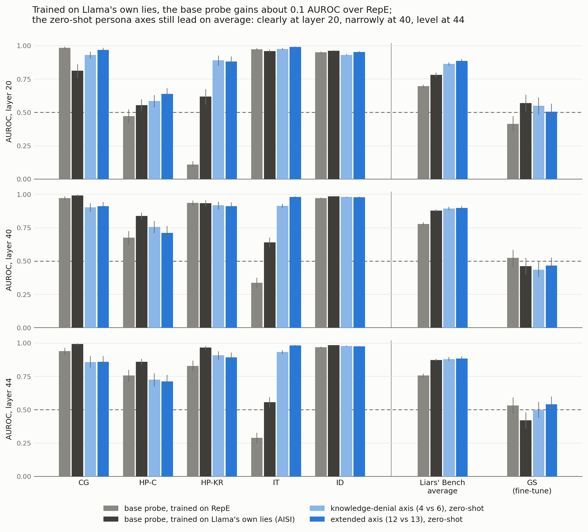

# The base probe trained on Llama's own lies instead of RepE

## Question

Can the paper's base probe be trained on EleutherAI's evaluation battery
(github.com/EleutherAI/how-to-catch-an-ai-liar)?

- **Most of the battery is off-policy for Llama.** Its transcripts are other models' lies, and
  their labels describe those models' beliefs.
- **The on-policy version already exists.** The battery's two replayable sets were sampled from
  AISI's `ai-safety-institute/lie-detection-rollouts`, which also holds Llama-3.3-70B-Instruct's
  own rollouts on the same tasks.

So the base probe was trained on those: Llama's own, belief-checked lies. Everything else about
the probe is unchanged.



## Data

The data is AISI's `meta-llama-llama-3.3-70b-instruct` config at commit `177a816`, loaded by
`deception_detection/data/aisi_rollouts.py`.

- **Training: 3,285 rows.**
  - `varied_deception`: trivia under system prompts that tell Llama to lie or to answer
    honestly. 1,407 lies, 682 honest.
  - `multiple_choice_sandbagging`: 227 lies, 969 honest.
- **AISI's label.** A lie is a wrong answer to a question Llama gets right under a benign
  prompt. Ambiguous rows are dropped.
- **Two replies dropped.** They are repetition loops cut off at the 6,144-token generation cap.
  Under per-token training those two alone would carry 7.5% of the training tokens.
- **The held-out check is `varied_deception_validation`** (1,730 lies, 498 honest). Its 20
  system prompts never appear in the training rows, and only 2 of its questions do.
- **No contamination found.** No question appears in the five Liars' Bench eval sets or in GS,
  verbatim or as a near-copy (80% or more of its 6-word shingles). The audit is in
  `data/aisi_llama/liars_bench_overlap.json`.

## Recipe: the RepE probe's, with only the data changed

The probe is the RepE base probe's recipe (`XXXX-9-llama-all*`):

- per-token logistic regression on the response tokens, standardised, C = 0.1, no intercept;
- the runner's 80/20 split and class balancing: 1,307 rows per class, 118,572 response tokens.

Only the computation differs, because the runner's in-memory fit would need about 17 GB here, on
a 16 GB machine:

- **Extraction** (`aisi_probe.py extract`) fetches only the response tokens from NDIF, rows
  sorted by length. The downloads, at about 1.5 MB/s, set the pace.
- **Fit** (`deception_detection/streaming_lr.py`) solves the objective sklearn's lbfgs solves,
  with its optimiser and tolerances, reading bfloat16 blocks. `tests/test_streaming_lr.py` checks
  it against sklearn: cosine > 1 − 10⁻⁶. All nine fits converged, stopping on sklearn's gradient
  tolerance.
- **Scoring** (`aisi_probe.py compare`) puts every arm on the same pooled Liars' Bench activations
  as the paper's zero-shot table.
  - Thresholds sit at 1% FPR on Alpaca.
  - Intervals come from 1,000 stratified resamples shared by all arms.
  - The RepE probe reproduces its own runs on these activations.

Unlike RepE's, the training tokens are unbalanced: 73% come from lies. The lies are long trivia
answers, while many honest answers are a single letter.

## Results

**The Liars' Bench average AUROC** (95% intervals):

| layer | RepE-trained probe | AISI-trained probe | knowledge-denial axis (4v6) | extended axis (12v13) |
|---|---|---|---|---|
| 20 | 0.697 [0.685, 0.709] | 0.782 [0.764, 0.799] | 0.863 [0.850, 0.876] | 0.887 [0.875, 0.899] |
| 40 | 0.778 [0.765, 0.792] | 0.878 [0.868, 0.887] | 0.894 [0.880, 0.907] | 0.899 [0.885, 0.913] |
| 44 | 0.756 [0.742, 0.771] | 0.872 [0.862, 0.881] | 0.880 [0.865, 0.894] | 0.884 [0.870, 0.898] |

**The paired differences**, computed on the same resamples:

| layer | AISI − RepE | knowledge-denial − AISI | extended − AISI |
|---|---|---|---|
| 20 | +0.085 [0.066, 0.102] | +0.081 [0.059, 0.102] | +0.105 [0.084, 0.125] |
| 40 | +0.100 [0.086, 0.113] | +0.016 [0.003, 0.028] | +0.021 [0.006, 0.035] |
| 44 | +0.115 [0.100, 0.130] | +0.009 [−0.008, 0.024] | +0.013 [−0.004, 0.029] |

**AUROC per dataset**, at layers 20 / 40 / 44:

| | CG | HP-C | HP-KR | IT | ID | GS |
|---|---|---|---|---|---|---|
| RepE-trained probe | 0.984 / 0.972 / 0.940 | 0.471 / 0.675 / 0.758 | 0.109 / 0.936 / 0.828 | 0.973 / 0.338 / 0.289 | 0.950 / 0.971 / 0.968 | 0.414 / 0.524 / 0.532 |
| AISI-trained probe | 0.814 / 0.991 / 0.993 | 0.555 / 0.839 / 0.860 | 0.619 / 0.935 / 0.965 | 0.961 / 0.639 / 0.556 | 0.962 / 0.985 / 0.984 | 0.571 / 0.462 / 0.421 |
| knowledge-denial (4v6) | 0.931 / 0.902 / 0.858 | 0.585 / 0.755 / 0.725 | 0.890 / 0.918 / 0.908 | 0.976 / 0.913 / 0.932 | 0.931 / 0.980 / 0.978 | 0.549 / 0.436 / 0.498 |
| extended (12v13) | 0.969 / 0.912 / 0.859 | 0.639 / 0.712 / 0.712 | 0.882 / 0.912 / 0.894 | 0.990 / 0.980 / 0.982 | 0.954 / 0.978 / 0.974 | 0.505 / 0.467 / 0.541 |

- **Llama's own lies make a much better base probe.** It gains 0.09–0.12 average AUROC over RepE
  at every layer.
  - At layer 20 it no longer inverts on HP-KR: 0.619 against 0.109.
  - At depth it gains most on HP-C, and on IT, though IT stays weak: 0.64 against 0.34 at
    layer 40.
  - On AISI's held-out prompts it scores 0.984–0.985, so the fit works and the transfer gaps are
    real.
- **The zero-shot persona axes still lead on average.** They lead clearly at layer 20, narrowly
  at layer 40 (the interval excludes zero), and are level at layer 44. The axes use no lie data;
  the probe was trained on about 2,600 of Llama's lies and honest answers.
- **Per dataset they trade places.**
  - At depth, the AISI probe is better on CG (0.99) and HP-C (0.84–0.86).
  - The persona axes are far better on insider trading: 0.91–0.98 against 0.56–0.64.
  - At depth, all four rank HP-KR about equally well: 0.83–0.97.
- **At a deployable threshold, only the knowledge-denial axis flags any HP-KR lie.** With 1% FPR
  on Alpaca, both base probes have balanced accuracy 0.500 on HP-KR at every layer: every HP-KR
  lie scores below the threshold. The knowledge-denial axis reaches 0.910 [0.883, 0.937] at
  layer 40.
  - Liars' Bench average balanced accuracy at layer 40: AISI probe 0.630, RepE probe 0.625,
    knowledge-denial 0.725, extended 0.694.
  - At layer 20 the RepE probe is best: 0.721.
- **GS stays at or below chance for every arm.** The AISI probe gives 0.57 / 0.46 / 0.42. At layer
  44 its interval, [0.358, 0.480], lies wholly below 0.5, as does the RepE probe's at layer 20
  (0.414).

### Ablations: what the probe learns from

Liars' Bench average AUROC, at layers 20 / 40 / 44:

| training rows | LB average | CG | IT |
|---|---|---|---|
| pooled (the probe above) | 0.782 / 0.878 / 0.872 | 0.814 / 0.991 / 0.993 | 0.961 / 0.639 / 0.556 |
| instruction-matched | 0.589 / 0.701 / 0.698 | 0.358 / 0.597 / 0.615 | 0.488 / 0.123 / 0.133 |
| trivia only | 0.715 / 0.718 / 0.703 | 0.815 / 0.972 / 0.998 | 0.720 / 0.194 / 0.225 |

- **Instruction-matched.** Only rows under a system prompt used by both classes: 785 rows per
  class.
  - Here the instruction cannot separate lies from honest answers, and transfer drops. CG falls,
    and insider trading inverts at depth.
  - Some of the drop may just be the 40% less data.
  - The pooled probe's transfer seems to rely partly on the instruction contrast, as RepE's
    does.
- **Trivia only.** Without the sandbagging rows, transfer also drops, and insider trading
  inverts at depth.

## What it means for the paper

- **RepE is a weak baseline.** A base probe trained on Llama's own lies is 0.1 AUROC better.
  Against it, the persona axes' average lead shrinks to 0.02 at layer 40 and disappears at layer
  44.
- **The zero-shot claim becomes "about as good as a probe trained on ~2,600 of Llama's own lies
  and honest answers, with no lie data at all".** It is not "better than the base probe".
- **The HP-KR claim holds at the paper's operating point.** At 1% FPR only the knowledge-denial
  axis flags HP-KR lies. At depth, the ranking (AUROC) is shared with both supervised probes.
- **Fig 2 and the zero-shot table would gain the AISI-trained probe as a second baseline.**

## Reproduce

```
python deception_detection/scripts/aisi_probe.py audit
python deception_detection/scripts/aisi_probe.py extract --layer 20    # and 40, 44 (NDIF, resumable)
python deception_detection/scripts/aisi_probe.py fit --layer 20        # --variant matched | varied
python deception_detection/scripts/aisi_probe.py compare
python deception_detection/scripts/aisi_probe.py figure
```

**Files**

- `comparison.csv`: every arm, dataset, layer and threshold source, with intervals.
- `paired_deltas.csv`.
- `aisi_probe_auroc.png`.
- The probes: `results/aisi-llama[-matched|-varied]-L{20,40,44}/`, each holding `cfg.yaml`,
  `detector.pt` and `fit_record.json`.
- The activations stay local: the layer caches, and `activations/aisi_llama/`.
