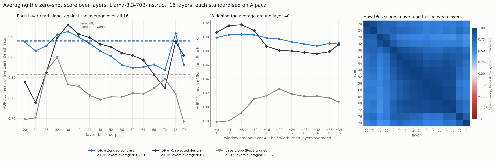

# Averaging the zero-shot score over layers

Every zero-shot result in the study reads a single layer, fixed in advance at 40, while the depth
sweep shows that the choice of layer matters (`../persona_depth/summary.md`): D9 ranks best at layer
36, and D8's HP-KR operating point is a spike at layer 40. We test whether averaging each response's
score over layers removes that choice without costing accuracy. The rule stays zero-shot. Each
layer's score is standardised on Alpaca, using the mean and standard deviation of the control's
scores at that layer, and every layer receives equal weight, which is the rule
`recall_denial.standardised_sum` already applies across directions when it builds D9 + K.



## Setup

We score six arms on the mean-pooled responses at all 16 sweep layers: D5 (8v7), D8 (knowledge
denial, 4v6) and D9 (extended, 12v13) from the 36-persona bank, K, D9 + K, and the RepE-trained base
probe as a supervised control. Three kinds of layer set are averaged: all 16 layers, which selects
nothing; windows centred on layer 40 at half-widths 4 to 36, named by the layers they span (e.g.,
`L36-44`); and each single layer as the reference. The mean of the 16 single-layer results is
reported beside them, since it is what a layer picked at random scores on average.

The metrics are the thesis's (zero-shot AUROC per dataset and over the five Liars' Bench sets, HP-KR's
identical-text and denial slices, balanced accuracy at 1% FPR on Alpaca, the share of lies caught at
1% FPR with an in-setting cutoff, and train-one-test-all transfer with the averaged score as a
one-dimensional feature). Paired stratified row bootstraps (1,000 draws, as in `k_robustness.paired`)
compare the all-16 average with layer 40 and with the best single layer, and the two narrowest
windows with layer 40. Everything runs locally from the pooled activations already on disk.

## Results

Five-dataset mean AUROC, zero-shot:

| arm | layer 40 | best single layer (post hoc) | mean of single layers | all 16 averaged | L36-44 averaged | L32-48 averaged |
|---|---|---|---|---|---|---|
| D9 | 0.899 | 0.913 (L36) | 0.864 | 0.891 | 0.903 | 0.904 |
| D9 + K | 0.906 | 0.929 (L36) | 0.851 | 0.889 | 0.916 | 0.917 |
| K | 0.824 | 0.854 (L36) | 0.744 | 0.807 | 0.850 | 0.855 |
| D8 | 0.894 | 0.895 (L36) | 0.837 | 0.864 | 0.890 | 0.886 |
| D5 | 0.798 | 0.852 (L76) | 0.760 | 0.774 | 0.796 | 0.796 |
| base probe | 0.778 | 0.850 (L32) | 0.761 | 0.807 | 0.780 | 0.792 |

**The all-layer average is worse than layer 40 for every zero-shot arm.** Against layer 40, the
all-16 average loses 0.008 for D9 (95% CI [−0.015, −0.000]), 0.017 for D9 + K ([−0.025, −0.009]),
0.018 for K, 0.030 for D8 and 0.024 for D5, all with intervals below zero (`paired.csv`). The losses
against the best single layer are larger (0.022 for D9 and 0.040 for D9 + K, both at layer 36),
though that layer was picked on the same rows. The average does beat the mean of the single layers
for every arm (D9 0.891 against 0.864; D9 + K 0.889 against 0.851), making it a better hedge than a
layer chosen at random but not a better detector than the layer fixed in advance.

**The loss is concentrated on HP-KR, where K is inverted at shallow layers.** For D9 + K, HP-KR falls
from 0.909 at layer 40 to 0.790 in the all-16 average (Δ −0.119 [−0.149, −0.092]) and its denial
slice from 0.724 to 0.641, since K ranks HP-KR at 0.25–0.44 AUROC at layers 20–28 and those layers
enter the average with full weight. HP-C gains instead (0.820 to 0.872, Δ +0.051 [+0.028, +0.074]),
while the identical-text slice does not change significantly (Δ −0.012 [−0.027, +0.002]). D9 alone
shows the same pattern on a smaller scale, losing on CG (−0.041) and HP-KR (−0.025) while gaining
on HP-C (+0.027, with an interval that includes zero).

**Narrow windows around layer 40 help slightly, but they are post hoc.** Averaging layers 36, 40 and
44 raises the five-dataset mean of D9 + K by 0.010 ([0.007, 0.013]), of D9 by 0.004 ([0.001, 0.008])
and of K by 0.025 ([0.022, 0.029]), and transfer rises with it (D9 + K 0.922 to 0.930; D9 0.916 to
0.919). For D9 + K, the gain comes mostly from HP-C (+0.045), at a cost on HP-KR's denial slice
(−0.020), while the identical-text slice stays at 0.787. We noticed these windows on the same rows
they are scored on, and none reaches the best single layer (0.929 for D9 + K at layer 36), so they
describe the plateau of the depth curve rather than a new design.

**Averaging makes D8's HP-KR operating point less dependent on layer 40.** D8's balanced accuracy on
HP-KR at 1% FPR on Alpaca is 0.910 at layer 40 and at most 0.760 at any other single layer (0.745 at
36, 0.757 at 44). The all-16 average reaches 0.825, above every single layer except 40, while the
averages over layers 36–44 and 32–48 keep 0.911 and 0.906. These operating-point numbers carry no
interval.

**The base probe is the only arm that gains from the full average.** Its five-dataset mean rises
from 0.778 at layer 40 to 0.807 (Δ +0.029 [+0.021, +0.036]), mostly on HP-C (+0.129) and IT
(+0.031, though IT stays inverted at 0.369). It remains below its own best layer (0.850 at layer 32)
and below the all-layer averages of D8, D9 and D9 + K.

**The layers' scores are highly correlated, which limits what an average can cancel.** On honest
rows, the Spearman correlation of D9's standardised scores is 0.75–0.99 between adjacent layers and
0.58–0.95 between layer 40 and any other layer, while layers 36–72 correlate with each other at a
median of 0.91 (right panel). An equal-weight average of such scores behaves mostly like an average
of the layers' separations, which places it between the best and the worst layers rather than above
the best.

The other metrics agree. Transfer follows the five-dataset mean (all-16 average against layer 40:
D9 0.909 against 0.916, D9 + K 0.907 against 0.922). At the benchmark threshold, the all-16 average
lowers the five-dataset balanced accuracy of D9 (0.651 against 0.694) and D9 + K (0.684 against
0.701), while the share of lies caught at 1% FPR with an in-setting cutoff rises slightly (D9 0.473
against 0.465; D9 + K 0.402 against 0.381; no interval).

## What it means

- **Averaging over all layers is not a way to avoid choosing one.** It costs every zero-shot arm
  accuracy relative to the layer fixed in advance, so it gives no reason to revisit layer 40.
- **It is a hedge.** It beats a randomly chosen layer by 0.014 (D5) to 0.063 (K), which would matter
  for a model whose layers have not been swept.
- **A narrow window is the only multi-layer read that does not cost accuracy.** Its gain for D9 + K
  (+0.010) is significant but post hoc, and smaller than the post hoc gain of moving to layer 36
  (+0.023).
- **D8's HP-KR detection is less isolated than the single-layer curve suggests.** Averaging keeps
  0.825 over all 16 layers against at most 0.760 for any single layer other than 40, though without
  an interval.

## Checks

- **Rows.** Nothing in the pooled files names a row, so `scores` checks that each layer's rows are the
  same responses as the previous layer's. The labels match, and at least 98.9% of rows sit closer to
  their own previous-layer vector than to a random row's at all 105 dataset and layer-pair checks,
  against about 50% for a shuffled file (`alignment.csv`). A cut on the random rows' 99th percentile
  was tried first and would have failed aligned files, because HP-KR's templated denials make random
  pairs of its rows alike.
- **Reproduction.** A one-layer average is the stored single layer, since standardising is affine,
  and all 560 single-layer numbers reproduce the stored results to within 0.001
  (`../recall_denial/k_robustness/depth.csv`, `../recall_denial/transfer/depth_ninek.csv`,
  `../persona_depth/depth.csv`).
- **K and standardisation.** K is rebuilt at each layer from the stored reads and matches
  `directions.npz` where it is stored, and every layer's standardised Alpaca scores have mean 0 and
  standard deviation 1.

## Files

- `scores.npz`: raw scores of the six arms at the 16 layers on every dataset, Alpaca included, with
  the labels.
- `summary.csv`: every arm over every layer set (16 single layers, 9 windows, all 16 and the mean of
  the single layers), with every metric.
- `paired.csv`: the paired bootstraps per dataset, per HP-KR slice and on the five-dataset mean.
- `correlation.csv`: the 16 × 16 Spearman correlations per arm, over all rows and over honest rows.
- `alignment.csv`: the row check.
- `layer_average.png`.

The CSVs are rounded to four decimals; the numbers above come from the unrounded values.

## Reproduce

```
python deception_detection/scripts/layer_average.py scores    # local, about 5 minutes
python deception_detection/scripts/layer_average.py analyse   # about 3.5 minutes
python deception_detection/scripts/layer_average.py figure
```
