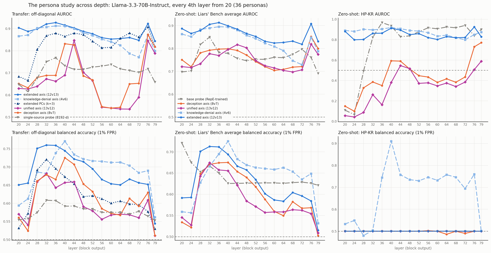

# The persona study across depth: every 4th layer from 20 to the last

The study had three depth points: layers 20, 40 and 44. This adds 13 more, so every 4th layer from
20 to 76 is covered, plus 79, the final block. Llama-3.3-70B-Instruct, six Liars' Bench datasets,
36 personas from `persona including knowlede denial/`, and the same analysis at every layer
(`persona_ood.py run` and `zeroshot`, per-layer folders `../persona_ood_ext_L*/`).



Six panels: ranking (AUROC) on top, the 1% FPR operating point below, with the columns being
off-diagonal transfer, the Liars' Bench average and HP-KR. The **unified axis (13v12)**, the
paper's own widening of the deception contrast with sycophancy, runs beside the others as the
control for the extended axis; `../persona_unified/summary.md` is about that comparison, and
`../persona_depth_orig/` repeats this figure for the published 26 personas.

## How the new layers were built

Layers 20, 40 and 44 were pooled from the runner's per-token cache, about 60 GB a layer. At this
machine's ~2 MB/s from NDIF that is hours per layer, so the new layers were built differently, and
the difference was measured, not assumed:

- **Pooling ran on NDIF** (`layer_sweep.py pool`): each example's mean over its detected tokens,
  every layer in one forward pass, 4.05M tokens over the eight datasets.
- **The RepE base probe was trained by the runner's own code**, with `acts_positions: tail`, so
  only RepE's statement tokens were fetched. The runner never scored these probes, so they have no
  `results_table.csv` and enter the zero-shot table without that check.
- **Layer 40 was rebuilt both ways and compared** (`layer_sweep.py check40`):
  - pooled vectors agree to row cosine ≥ 0.99989, and give the same knowledge-denial AUROC to four
    decimals (CG 0.9019 vs 0.9020; RepE validation 1.0000 vs 1.0000);
  - the retrained RepE probe matches the original's direction at cosine 0.9996, and its AUROCs on
    the five Liars' Bench sets land within 0.0017 of the original run's table.
- **Every layer's pooled files hold exactly the rows layer 40's hold**, dataset by dataset.
- **Every new RepE probe scores 1.0000 on the RepE validation split**, as the originals do.

## What the curves show

**Ranking peaks at layer 36, not 40.** The extended axis's best off-diagonal transfer AUROC is
0.927 at layer 36, against 0.916 at 40 and 0.904 at 20. Its zero-shot Liars' Bench average is 0.913
at 36, against 0.899 at 40. The three layers the paper reports bracket the peak without landing on
it. The differences are small, though, and no interval is computed here.

**The HP-KR operating point is a narrow peak at layer 40.** Balanced accuracy at 1% FPR on Alpaca:

| layer | 28 | 32 | 36 | **40** | 44 | 48 | 64 | 76 | 79 |
|---|---|---|---|---|---|---|---|---|---|
| knowledge-denial axis | 0.480 | 0.504 | 0.745 | **0.910** | 0.757 | 0.735 | 0.757 | 0.760 | 0.501 |

Its neighbours reach only about 0.75, and no other arm flags a single HP-KR lie at any layer: the
base probe, the extended axis and the unified axis sit at exactly 0.500 from layer 20 to 79, and
the deception axis never leaves 0.486–0.503. So the
paper's headline number is real but sits on a spike, while the *ability* to flag these lies at all
holds broadly, from layer 36 to 76.

**But HP-KR *ranking* is a different story, and the base probe wins it at depth.** This is what
the new AUROC panel shows and the earlier four-panel figure hid. The base probe's HP-KR AUROC
climbs from 0.109 at layer 20 — inverted, the number quoted in `../persona_ood_ext_L20/summary.md`
— to **0.967 at layer 36**, and stays between 0.83 and 0.94 through layer 79, above the
knowledge-denial axis (0.799–0.918) at most deep layers. Its balanced accuracy is nevertheless
exactly 0.500 everywhere: it ranks HP-KR's lies well but no HP-KR score clears the Alpaca 1% FPR
threshold, so it flags none of them. **The inversion is a layer-20 phenomenon for the base probe
just as it is for the deception axis**, and what stays uniquely true of the knowledge-denial axis
across depth is the operating point, not the ranking.

**The base probe's best layer is 32, none of the three in the paper.** Its Liars' Bench average
AUROC is 0.850 at layer 32, against 0.697 at 20, 0.778 at 40 and 0.756 at 44. The persona axes still
lead there (extended 0.905, knowledge-denial 0.889), but the gap narrows from 0.19 at layer 20 to
0.055 at layer 32. A depth sweep of the baseline is the fairer comparison, and it costs the
zero-shot claim some of its margin.

**The persona axes lead the supervised transfer baseline everywhere.** The single-source 8192-d
probe stays between 0.61 and 0.77 off-diagonal at every depth, below the extended axis at all 16
layers.

**Widening the contrast is not what helps — these roles are.** The unified axis (13v12), which
widens the published 8v7 contrast with sycophancy exactly as the extended axis widens it with
knowledge denial, averages 0.657 off-diagonal against the deception axis's 0.686 and the extended
axis's 0.885, and ranks HP-KR *below* the published axis at 15 of 16 layers. Full comparison in
`../persona_unified/summary.md`.

**Layers 56 to 72 are a trough, and layer 76 a second peak.** The extended axis falls to 0.847–0.860
transfer AUROC through 56–72, then reaches 0.923 at layer 76 before collapsing to 0.844 at 79, the
final block. The published deception axis (8v7) swings hardest: 0.540 at layer 60, its worst
anywhere, and 0.874 at 76, its best. What makes layer 76 stand out is not explained here.

**The knowledge-denial axis fades with depth where the extended axis does not.** From 0.912 at
layer 36 it falls to 0.771 at 72, while the extended axis stays above 0.84 at every layer. The extra
personas buy stability at depth.

## What it means for the paper

- **The "three layers" limitation can be replaced by a curve.** Every headline metric now has 16
  depth points.
- **Layer 40 should be described as a peak, especially for HP-KR.** The 0.910 balanced accuracy is
  a spike; the neighbouring layers give about 0.75.
- **The base probe should be quoted at its own best layer (32, 0.850)** wherever the zero-shot
  comparison is made, not only at the layers chosen for the persona axes.
- **The HP-KR claim must be stated as an operating-point claim, not a ranking one.** At depth the
  base probe ranks HP-KR better than any persona axis (0.967 AUROC at layer 36) while flagging
  nothing at 1% FPR. Saying the persona axes "fix HP-KR" is only defensible about the threshold.
- **The unified axis belongs in the paper as the control**, since it answers the obvious question
  — whether any wider persona set would do — with a no.

## Files

- `depth.csv`: every number in the figure, long format (layer, bank, source, arm, metric, value).
- `depth.png`.
- `../persona_depth_orig/`: the same table and figure from the published 26 personas.
- `../persona_unified/`: the unified axis as the control for the extended one.
- The per-layer folders `../persona_ood_ext_L{24,28,32,36,48,52,56,60,64,68,72,76,79}/`, each with
  the transfer matrices, `summary*.csv`, the zero-shot tables, seven figures and a short
  `summary.md`.
- The probes `../XXXX-9-llama-all-L*/` and the pooled activations `activations/pooled_L*/` (local).

## Reproduce

```
python deception_detection/scripts/layer_sweep.py check40
python deception_detection/scripts/layer_sweep.py pool            # NDIF, resumable; --shard i/n to split a dataset
python deception_detection/scripts/layer_sweep.py probe --layer 24
python deception_detection/scripts/layer_sweep.py analyse --layer 24
python deception_detection/scripts/layer_sweep.py depth
```
