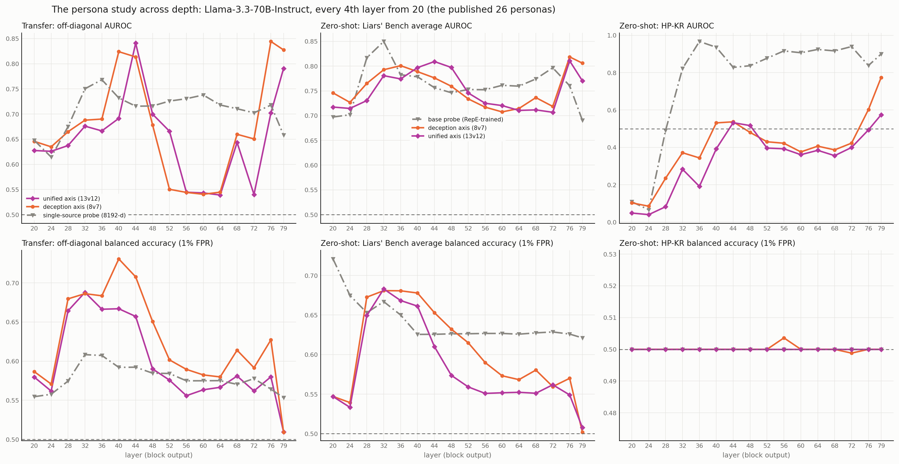

# The published 26 personas across depth

The same sweep as `../persona_depth/`, but with the persona vectors from `persona vectors/
vectors_s3/` — the published 26 roles, whose layer-20 slice is bit-identical to
`paper16_L20.pt` — instead of the 36-persona extraction. Same pooled activations, same RepE base
probes, same six Liars' Bench datasets; only the directions the activations are scored against
differ.



This folder exists for one comparison: the **unified axis** here is the paper's own
harmful-behaviour direction, built from the roles and rollouts the paper published, while the
unified axis in `../persona_depth/` is rebuilt on the larger extraction. The two agree at every
layer, which is what rules out the re-extraction as an explanation of anything in
`../persona_unified/summary.md`.

This folder has **no extended or knowledge-denial arms** — those roles exist only in the extended
folder, so those series are absent from the figure rather than flat.

| mean over 16 layers | transfer, all six | transfer, excl. HP-KR | zero-shot LB average AUROC |
|---|---|---|---|
| deception axis (8v7) | 0.675 | 0.831 | 0.757 |
| unified axis (13v12) | 0.652 | 0.837 | 0.751 |

The unified axis ranks HP-KR below the deception axis at 15 of 16 layers here too, and clears
chance at only three (44, 48, 79). See `../persona_unified/summary.md` for the full argument.

## Reproduce

```
python deception_detection/scripts/layer_sweep.py analyse --layer 36 --bank orig
python deception_detection/scripts/layer_sweep.py depth --bank orig
```

Layers 20 and 40 were also built before, from the runner's per-token cache, as
`../persona_ood/` and `../persona_ood_L40/`. The new `../persona_ood_orig_L20/` and `_L40/`
reproduce them cell for cell on every shared arm, which is what checks this pipeline against the
original one.
