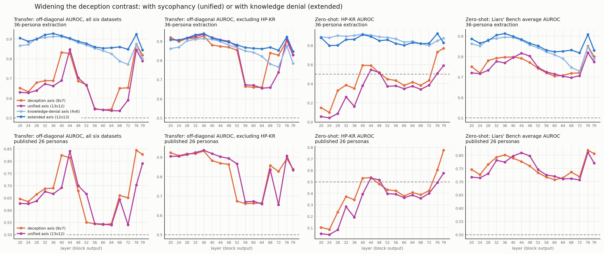

# The unified axis: does *any* wider persona set fix HP-KR, or only these roles?

The persona paper (arXiv 2605.09391, App. C) builds a **unified harmful-behaviour axis** by
pooling its deception and sycophancy personas over a balanced 10+10 question set. This study
builds an **extended axis** the same way but with knowledge-denial roles. Both widen the
published 8v7 deception contrast by five roles a side, so the unified axis is the control that
separates two explanations of the extended axis's gain:

- *a wider persona set helps* — then the unified axis should gain too;
- *these particular roles help* — then only the extended axis should.

**The second one is what happens.** Widening with sycophancy buys nothing on average and costs on
HP-KR; widening with knowledge denial is what fixes it.



## The result

Mean over all 16 swept layers, 36-persona extraction:

| arm | transfer, all six | transfer, excl. HP-KR | zero-shot LB average AUROC |
|---|---|---|---|
| deception axis (8v7), published | 0.686 | 0.839 | 0.760 |
| **unified axis (13v12), +sycophancy** | **0.657** | **0.833** | **0.751** |
| knowledge-denial axis (4v6) | 0.861 | 0.858 | 0.837 |
| extended axis (12v13), +knowledge denial | 0.885 | 0.893 | 0.864 |

The unified axis is **slightly behind the axis it widens on every aggregate**. Its one edge is at
its best layer: 0.937 off-diagonal excluding HP-KR at layer 36, against the deception axis's
0.927 — but averaged over depth that edge disappears (0.833 against 0.839).

On HP-KR it is worse, not merely no better:

| HP-KR zero-shot AUROC | L20 | L32 | L40 | L56 | L79 |
|---|---|---|---|---|---|
| deception axis (8v7) | 0.148 | 0.385 | 0.593 | 0.434 | 0.771 |
| **unified axis (13v12)** | **0.056** | **0.261** | **0.381** | **0.377** | **0.589** |
| extended axis (12v13) | 0.882 | 0.862 | 0.912 | 0.820 | 0.828 |

The unified axis ranks HP-KR **below the published axis at 15 of 16 layers**, and clears chance at
only four of them (44, 48, 76, 79). The published 26-persona folder gives the same picture:
15 of 16, chance cleared at three.

## Why it goes the wrong way

`persona_ood_ext_L20/summary.md` traced HP-KR's inversion to the axis encoding **confident
assertion = deceptive**, while HP-KR's deceptive response is a *denial* ("I do not know the
answer", 87% of its deceptive rows). Sycophancy roles — `pc_cheerleader`, `pc_flatterer`,
`pc_yes_man` — assert agreeably, so they sit on the same side of that encoding. The sycophancy
axis on its own is the **most** inverted arm on HP-KR of any tested: 0.042 AUROC at layer 20,
below even the deception axis's 0.103. Pooling it in therefore pushes HP-KR further down rather
than relaxing the constraint.

The geometry agrees. At layer 20 the unified axis sits almost exactly between its parents,
|cos| = 0.878 to the deception axis and 0.877 to the sycophancy axis, which are themselves at
0.540. It is a genuinely new direction, not a rescaling of either — it simply points the wrong
way for this dataset.

## What it does not show

- **Sycophancy personas are not useless.** Excluding HP-KR the unified axis is within 0.006 of
  the deception axis averaged over depth, and at layer 40 it beats it on CG (0.975 against 0.865
  AUROC) and HP-C. The failure is specific to HP-KR.
- **This is not a claim about the paper's own results.** The paper uses the unified axis for
  steering and its own evaluations, not for Liars' Bench transfer. What is tested here is only
  whether it transfers to these six datasets.
- **Both folders, one conclusion.** The `orig` sweep (published 26 personas; its layer-20 slice
  is bit-identical to `paper16_L20.pt`) and the `ext` sweep (36 personas, the same extraction as
  the extended axis, so no "more rollouts" confound) agree at every layer.

## Files

- `unified.csv`: every number in the figure, long format (bank, layer, arm, metric, value).
- `unified_axis.png`, `summary_tables.md` (each arm's best layer per metric).
- Per layer: `../persona_ood_ext_L*/` and `../persona_ood_orig_L*/`, 16 layers each, with the
  unified arm in the transfer matrices (`uni_axis1`, `uni_pc3`), the zero-shot tables
  (`auroc_uni_axis`, `auroc_uni_pc1`) and `zero_shot_fig2.png`.
- Depth curves: `../persona_depth/` (36 personas) and `../persona_depth_orig/` (published 26).

## Reproduce

```
python deception_detection/scripts/layer_sweep.py analyse --layer 36 --bank ext
python deception_detection/scripts/layer_sweep.py analyse --layer 36 --bank orig
python deception_detection/scripts/layer_sweep.py depth --bank ext
python deception_detection/scripts/unified_axis.py report
```

Adding the arm changed nothing that existed: across all 16 extended layers every persona arm
(`axis1`, `pc1`, `pc3`, `syc*`, `ext*`, `denial*`, `random3`) is bit-identical to the pre-sweep
files, and the only movement is the 8192-d `baseline` probe at up to 3.8e-4, from BLAS summation
order under `OMP_NUM_THREADS=3`. The new `persona_ood_orig_L20` and `_L40` reproduce the
published `persona_ood/` and `persona_ood_L40/`, which were built from the runner's own per-token
cache.
